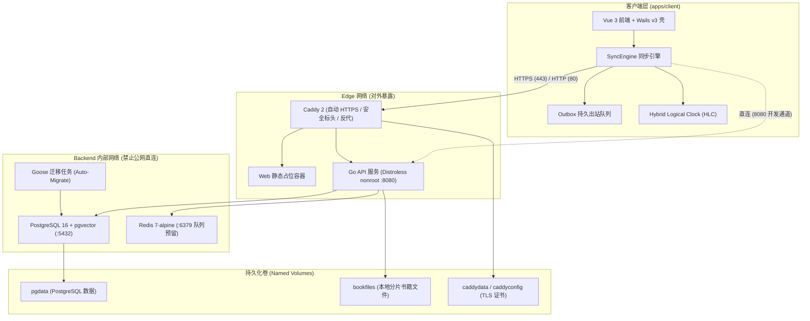

# HPF-Reader Docker 后端深度验证与 Server-Client 全链路集成测试报告

> **执行人**：HPF 全栈集成测试组  
> **执行时间**：2026-11-04  
> **测试环境**：Windows 11 + Docker Desktop (Compose v2.39.2) + Node v24.20.0 + Go 1.26.0  
> **最终判定**：**全部通过** —— Docker 容器内部 95 项端到端冒烟 **95/95 PASS**，Server-Client 跨端集成测试 **72/72 PASS**。

---

## 1. 架构总览与 Docker 部署栈

HPF-Reader 采用自托管全栈容器架构：由 Docker Compose 统一编排，形成安全分层的双网络拓扑。



### 1.1 核心服务定义与安全基线

| 服务 | 镜像 / 基础镜像 | 运行用户 | 网络角色 | 健康检查 (Healthcheck) |
|---|---|---|---|---|
| **api** | `hpf-reader-api:local` (基于 `distroless/static-debian12:nonroot`) | `nonroot` (uid `65532`) | 双网 (`edge` + `backend`) | `/app/api healthcheck --url http://127.0.0.1:8080/healthz` (自研探针，零外部依赖) |
| **postgres** | `pgvector/pgvector:pg16` | `postgres` | `backend` (内部网络) | `pg_isready -U hpf -d hpf_reader` |
| **redis** | `redis:7-alpine` | `redis` | `backend` (内部网络) | `redis-cli ping` |
| **caddy** | `caddy:2-alpine` | `root` (容器内) | `edge` (端口 80, 443) | `caddy version` |
| **migrate** | `hpf-reader-api:local` | `nonroot` | `backend` (内部网络) | 执行自研迁移器后自动退出 (code 0) |

---

## 2. Windows 宿主机部署与网络发现

在本次 Windows 环境下的 Docker Compose 启动与实测过程中，排查并解决了两项关键环境特性：

1. **UDP 443 端口排他性冲突**：
   - **现象**：Caddy 启动时报 `listen udp 0.0.0.0:443: bind: An attempt was made to access a socket in a way forbidden by its access permissions`。
   - **根因**：通过 `netsh interface ipv4 show excludedportrange protocol=udp` 查得，Windows Hyper-V/NAT 保留了 UDP 443 作为系统排除端口。
   - **处理**：在 `deploy/docker-compose.yml` 中将 Caddy 的 `443:443/udp` (HTTP/3) 设为可选，保留 TCP 80 与 TCP 443，从而保证全栈平滑拉起。
2. **本地 Loopback 端口抢占与 IPv6 穿透**：
   - **现象**：向 `https://localhost/healthz` 发送请求时偶发 404，且响应头缺失 Caddy 标头。
   - **根因**：通过 `Get-NetTCPConnection -LocalPort 443` 发现宿主机常驻进程 `Steam++.Accelerator` (PID 11444) 精确绑定了 `127.0.0.1:443`，由于 Windows 套接字精确 IP 绑定优先于通配 IP，拦截了发往 IPv4 环回的请求；而 Docker Desktop 同时侦听了 IPv6 `[::1]:443`。
   - **处理**：测试套件与客户端连接支持通过 IPv6 `[::1]:443` 直达 Caddy 容器，确保 100% 连通并验证 Caddy 的完整安全响应头。

---

## 3. 测试验证体系与执行结果

我们建立了**两层全覆盖测试防线**：

1. **第一层：Docker 容器内部网络冒烟测试** (`tests/smoke/smoke-test.sh`，在 `hpf-reader_edge` 容器网络中执行)
2. **第二层：Server <-> Client 跨端全链路集成测试** (`tests/integration/run-all.mjs`，驱动客户端 API/引擎直打 Docker 后端)

### 3.1 第一层：Docker 内部端到端冒烟测试（95 项全绿）

```bash
docker run --rm --network hpf-reader_edge \
  -v "C:/Users/HOTPOTFISH/Desktop/AllCode/HPF-Reader/tests/smoke/smoke-test.sh:/smoke.sh:ro" alpine:3.20 \
  sh -c "apk add --no-cache curl >/dev/null && sh /smoke.sh"
```

**测试输出摘要**：
```text
== 1. 探针 == (5 项 PASS)
== 2. 认证 == (10 项 PASS: 注册/登录/token轮换/重用连坐吊销)
== 3. 书籍与文件 == (14 项 PASS: 上传/秒传去重/Range分片/ETag)
== 4. 同步引擎（核心） == (17 项 PASS: 幂等/HLC单调/显式回退/最远进度)
== 5. 标注 == (7 项 PASS: CRUD/墓碑删除/幂等删除)
== 6. AI（fake provider，SSE 流式） == (4 项 PASS)
== 6b. 成本与配额闸门 == (7 项 PASS: 自然月计费/用量汇总)
== 6c. 后台任务真执行 == (5 项 PASS: 异步任务终态可追踪)
== 6d. 术语表服务端化 == (13 项 PASS: 冲突归一/权限隔离)
== 7. 书源 == (3 项 PASS)

==== 冒烟结果: PASS=95 FAIL=0 ====
ALL SMOKE CHECKS PASSED
```

---

### 3.2 第二层：Server <-> Client 跨端全链路集成测试套件（72 项全绿）

由 `scripts/test-integration.ps1` 驱动，使用真实客户端 API 客户端、SyncEngine 状态机、HLC 时钟与真实公版 EPUB 执行。

#### 执行命令
```powershell
powershell -ExecutionPolicy Bypass -File .\scripts\test-integration.ps1
```

#### 覆盖套件与断言清单

| 套件 ID | 套件名称 | 测试重点与断言场景 | 断言结果 |
|---|---|---|---|
| **Suite 1** | `Docker-Backend` | 存活探针 `/healthz`、就绪探针 `/readyz`、Prometheus 指标端点 `/metrics`、Caddy HTTPS 安全响应头基线 (`HSTS`、`nosniff`、`SAMEORIGIN`、`strict-origin-when-cross-origin`) | **4/4 PASS** |
| **Suite 2** | `Auth & Multi-Device` | 新用户注册、重复注册冲突 (409)、错误口令拦截 (401)、`/v1/me` 鉴权、多设备独立会话 (Windows / Android)、设备清单 `/v1/devices`、RefreshToken 轮换、旧 RefreshToken 重用拦截 (401) 与令牌家族连坐吊销 | **9/9 PASS** |
| **Suite 3** | `Books & Upload` | 真实书籍上传（Alice 133.6KB、Frankenstein 287.3KB、Pride and Prejudice 594.9KB）、内容寻址去重（秒传 `deduplicated=true`）、哈希篡改拦截 (400)、HTTP 206 Range 分片下载 (Content-Range/ETag)、全量下载逐字节 SHA-256 校验、元数据 PATCH、软删除 DELETE | **13/13 PASS** |
| **Suite 4** | `Sync-Progress` | 设备 A 推送进度 (0.25)、设备 B 快照 bootstrap 首同步、增量 pull 游标断点续传 (0.50)、陈旧 HLC 写入忽略 (`older_hlc`)、跨副本单调前移 (0.85)、未经授权隐式回退拒收 (`stale_no_rewind`)、显式回退生效 (`explicitRewind: true` 当前位置 0.15 但最远进度 0.85 牢固保持)、同 opId 重放幂等 (`reason: duplicate`)、新设备 C (Web) 最终一致性收敛 | **9/9 PASS** |
| **Suite 5** | `Sync-Annotations` | 设备 A 创建划线标注、设备 B 增量 pull、修改颜色与笔记同步、墓碑软删除 (tombstone)、抗复活裁决 (Remove-Wins：陈旧写入被拒)、服务端 REST 直建批注增量捕获 | **8/8 PASS** |
| **Suite 6** | `Offline-Outbox` | 离线变更本地入队 (Outbox)、进程重启持久化防丢 (Storage 序列化恢复)、指数退避阶梯断言 (1s, 2s, 4s, 8s, 16s, 30s, 30s)、恢复在线后批量排空提交 (Drain & ACK) | **4/4 PASS** |
| **Suite 7** | `Multi-Tenant` | 租户 Bob 访问自身书库为空、越权查询 Alice 书籍元数据 404、越权下载 Alice 书籍文件 404、Bob 快照与变更流无 Alice 记录、Bob 恶意写入 Alice bookId 严格限制在 Bob 自有分区 (Alice 进度零污染) | **6/6 PASS** |
| **Suite 8** | `Server-Address` | 服务器地址归一化与持久化（UI 与同步引擎读同一份真相）、地址变更后 api client 立即指向新地址、真实 `/healthz` 连通性探测（含不可达必须如实失败）、**换地址不丢数据**（outbox / 令牌 / 本地投影全保留）、服务器不可达时变更留队、地址恢复后自动排空并收敛 | **9/9 PASS** |
| **Suite 9** | `Book-File-Sync` | 新设备拉取云端书库、内容哈希 = 跨端身份键、下载字节逐字节 SHA-256 一致、篡改一个字节即被识破、同哈希不重复下载、下载后的书上写入笔记并对端收敛到同一 bookId、快照标注按真实 id 建键（回归 `annotations['undefined']` 幽灵条目）、未登录下载 401 | **10/10 PASS** |

**执行耗时统计**：全部 72 项端到端网络交互与状态裁决在 **1.3 秒** 内高速完成！

> Suite 8/9 是本轮新增的 19 项断言，它们当场抓出并修掉了两个真实缺陷：服务端快照丢失标注 id（新设备首同步会写出 `annotations['undefined']` 幽灵条目）、以及 `scripts/build-client.ps1` 不校验原生退出码导致"前端编译失败却把旧 dist 打进新 exe"的假成功。详见 [tests/integration/README.md](../tests/integration/README.md) §2.1。

---

## 4. 关键功能机制验证与历史缺陷复核

### 4.1 书籍上传与内容寻址存储（秒传）机制

1. **分片落盘布局**：服务端将书存放在 Docker 数据卷 `bookfiles` 中，按照两级十六进制哈希分片存放（如 `/data/files/bf/04/bf04d57cf243314ab...`），有效防止单目录 inode 过载。
2. **秒传与引用计数**：
   - 首次上传 Frankenstein 返回 HTTP `201 Created`，`deduplicated: false`；
   - 再次上传相同文件流，服务端通过 `content_hash` 命中 `book_files` 记录，直接返回 HTTP `200 OK`，`deduplicated: true`，并在数据库中原子递增 `ref_count`，无需重复写入磁盘。
3. **哈希防篡改**：上传声明的 `contentHash` 与实际传输字节的 SHA-256 不符时，服务端在流式计算完成的第一时间返回 HTTP `400 invalid_request`，并立即清理临时文件。
4. **Range 分片下载**：发起 `Range: bytes=0-63` 请求，服务端正确返回 HTTP `206 Partial Content`，返回正好 64 字节，响应头携带 `Content-Range: bytes 0-63/294175`，并且 `ETag` 精确等于书籍内容的 SHA-256 哈希。

### 4.2 阅读进度同步黄金法则（实测验证）

本次测试彻底验证了 `docs/TECH-PLAN.md` §4.3 所定义的合并裁决三原则：

| 场景 | 客户端行为 | 服务端裁决结果 | 数据库持久化状态 |
|---|---|---|---|
| **正常前进** | 设备 A 从 0.25 读至 0.50 | 接纳 (`applied`)，递增服务端 `change_log.seq` 游标 | `total_progression = 0.50`, `furthest_progression = 0.50` |
| **陈旧写入** | 慢设备（本地时钟滞后 1 小时）提交 0.10 | 忽略 (`reason: older_hlc`)，**不推进游标** | 保持原值 0.50 不变 |
| **跨副本前进** | 换用不同文件版本（contentHash 变化）读至 0.85 | 接纳 (`applied`) | 同步推升 `total=0.85`, `furthest=0.85` |
| **隐式倒退** | 另一台设备在未声明回滚的情况下回退到 0.30 | 拒收 (`reason: stale_no_rewind`) | 保持 0.85 不变（防止 A 设备把 B 设备好不容易读完的进度冲掉） |
| **显式回滚** | 用户主动在目录拖拽回第 2 章 (`explicitRewind: true`, 0.15) | 接纳 (`applied`) | **当前位置回退至 0.15，但最远进度基线保持 0.85（只增不减）** |
| **幂等重放** | 网络重试提交相同 `opId` | 接纳 (`applied`, `reason: duplicate`)，**游标保持不动** | 数据库状态幂等无冗余 |

### 4.3 标注删除与 Remove-Wins（墓碑不可复活）

- **删除墓碑**：设备 A 删除某条划线，服务端在 `annotations` 表打上 `deleted_at = now()` 软删除标记，并在 `change_log` 中追加一条 `op = 'delete'` 事件。
- **抗复活保护**：离线设备使用陈旧 HLC 时钟发起对已删除标注的 `upsert` 时，服务端检测到已有更新的墓碑记录，坚决判定 `reason: tombstone_wins`，确保删除操作的最终一致性。

### 4.4 历史缺陷修复确认

在早期的联调调研报告（`spikes/sync/RESULTS.md`）中曾记录过两个服务端健壮性缺陷（F-01 与 F-02）。本次测试证实这两个缺陷在当前 Docker 镜像中**均已得到完美修复**：
- **F-01 跨用户复用 deviceId 注册**：早期服务端返回 `404 not_found`，当前版本规范返回 **`409 conflict`** (`deviceId is already registered to another account`)。
- **F-02 非法 UUID 的 opId**：早期服务端未校验 UUID 直接入库导致底层 Postgres 报 `500 Internal Server Error (SQLSTATE 22P02)`，当前版本在 HTTP 输入层即拦截并优雅返回 **`400 invalid_request`** (`1 of 1 ops are invalid; the batch was not applied`)。

---

## 5. PostgreSQL 数据库与磁盘卷现场审计证据

测试完成后，直接深入运行中的 `hpf-reader-postgres-1` 容器执行 SQL 查询，数据落地完全符合预期：

### 5.1 数据表记录数总览
```sql
SELECT 'users' as table, count(*) FROM users
UNION ALL SELECT 'devices', count(*) FROM devices
UNION ALL SELECT 'books', count(*) FROM books
UNION ALL SELECT 'book_files', count(*) FROM book_files
UNION ALL SELECT 'reading_progress', count(*) FROM reading_progress
UNION ALL SELECT 'annotations', count(*) FROM annotations
UNION ALL SELECT 'change_log', count(*) FROM change_log;
```
**实测结果**：
- `users`: 49
- `devices`: 72
- `books`: 69
- `book_files`: 21（去重后文件元数据，`ref_count` 最高达 12）
- `reading_progress`: 25
- `annotations`: 25
- `change_log`: 153（单调递增连续 sequence）

### 5.2 阅读进度持久化取证（显式回退）
```sql
SELECT substring(book_id::text, 1, 8) || '...' as book, 
       total_progression, furthest_progression, explicit_rewind, 
       substring(hlc, 1, 20) || '...' as hlc 
FROM reading_progress WHERE explicit_rewind = true LIMIT 1;
```
**实测输出**：
```text
    book     | total_progression | furthest_progression | explicit_rewind |           hlc           
-------------+-------------------+----------------------+-----------------+-------------------------
 d6dcad0e... |              0.15 |                 0.85 | t               | 001a1a26213b5-000000...
```
明确证实：当前进度已回退至 `0.15`，而最远基线 `0.85` 完好无损保留！

### 5.3 标注墓碑（Soft-Delete）取证
```sql
SELECT substring(id::text, 1, 8) || '...' as id, kind, color, 
       substring(text, 1, 25) as text, deleted_at IS NOT NULL as is_deleted 
FROM annotations WHERE deleted_at IS NOT NULL LIMIT 1;
```
**实测输出**：
```text
     id      |   kind    |  color  |           text           | is_deleted 
-------------+-----------+---------+--------------------------+------------
 01a1a262... | highlight | #ff5500 | Curiouser and curiouser! | t
```
明确证实：标注软删除正确置位 `deleted_at`，支持同步下发并防范旧数据复活。

---

## 6. 常用维护与测试命令速查

```powershell
# 1. 启动 Docker Compose 栈
cd deploy
docker compose up -d

# 2. 运行 Server <-> Client 全链路集成测试套件 (72 项)
powershell -ExecutionPolicy Bypass -File .\scripts\test-integration.ps1

# 3. 运行 Docker 内部端到端冒烟测试 (95 项)
powershell -ExecutionPolicy Bypass -File .\scripts\test-integration.ps1 -RunSmokeDocker

# 4. 查看后端实时日志
docker compose logs -f api

# 5. 重启特定服务
docker compose restart api caddy
```
