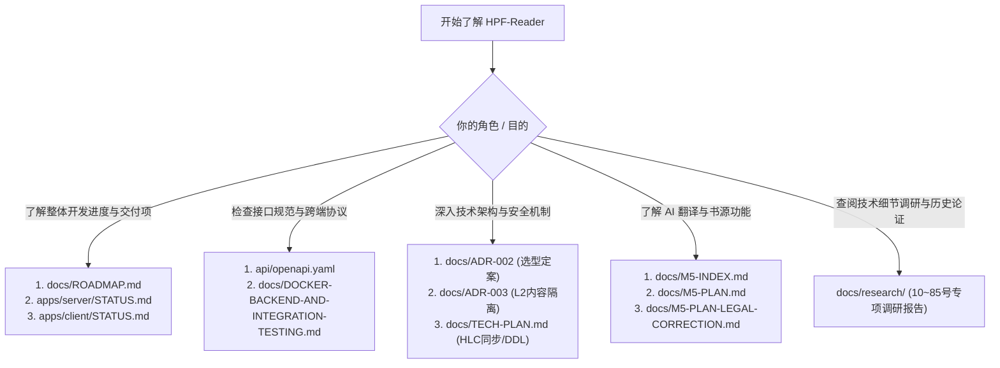

# HPF-Reader 文档索引与知识库总览

> **当前阶段**：**核心里程碑已全量交付（M1 ~ M5 / P0 ~ P4 全部完成）** ｜ 更新时间：2026-11-08  
> **验证基线**：全栈构建成功、95 项 Docker 容器冒烟全通、72 项跨端集成测试全通、269 项前端单测全通、Go 服务端单测全通。

---

## 一、推荐阅读顺序（按角色与场景）



---

## 二、文档体系全景清单

### 1. 核心状态与交付报告（了解“做成了什么”）

| 文档 | 作用与核心内容 | 重点关注 |
|---|---|---|
| [**ROADMAP.md**](ROADMAP.md) | **功能里程碑交付总表 (P0 ~ P4)**：从排版手势、双语翻译、云端同步到书源发现、墨水屏适配的完整交付现状。 | P0~P4 验收状态、后续规划 |
| [**apps/server/STATUS.md**](../apps/server/STATUS.md) | **服务端 (S端) 深度交付报告**：架构实现、PostgreSQL 迁移、HLC 同步裁决、AI 双维度配额、OPDS 书源、真模型实测。 | 冒烟测试断言、缺陷修复记录 (F-01~F-06)、思考 token 倍率 |
| [**apps/client/STATUS.md**](../apps/client/STATUS.md) | **客户端 (C端) 深度交付报告**：Wails 外壳、foliate-js 闭包隔离、老旧 WebView (Chromium 91) 三大阻塞修复、真实 exe 截图证据。 | L2 CSP 隔离策略、@layer 扁平化、内置 Polyfill 清单 |
| [**DOCKER-BACKEND-AND-INTEGRATION-TESTING.md**](DOCKER-BACKEND-AND-INTEGRATION-TESTING.md) | **Docker 后端验证与跨端全链路集成测试报告**：95 项容器内端到端冒烟 + 53 项跨端自动化测试实测结果。 | 双网络拓扑 (Edge/Backend)、多设备同步验证、Windows 网络避坑 |

---

### 2. 跨端契约（前后端唯一沟通权威）

| 文档 | 作用与核心内容 |
|---|---|
| [**api/openapi.yaml**](../api/openapi.yaml) | **OpenAPI 3.1.0 唯一权威契约**：覆盖系统、认证、书目、文件、HLC 同步、标注、AI 翻译、后台任务、用量配额、术语表、公版书源共 21 条路由与 31+ 核心 Schema。前端 `apps/client/frontend/src/api/schema.d.ts` 由此严格生成。 |

---

### 3. 架构决策记录 (ADR)

| 文档 | 状态 | 核心决策 |
|---|---|---|
| [**ADR-002-客户端落地-Vue与Wails.md**](ADR-002-客户端落地-Vue与Wails.md) | **当前生效** | 客户端采用 Vue 3 + Wails v3 方案；统一使用 Go 语言开发服务端与桌面移动宿主外壳；确立三大排期闸门与收敛策略。 |
| [**ADR-003-内容隔离架构.md**](ADR-003-内容隔离架构.md) | **当前生效** | 确立电子书内容安全隔离基线；判定 Arch-A（伪多协议）不可行，采用「同源 iframe + 逐节严格净化 + 逐节注入严格 meta CSP」的 L2 隔离方案。 |
| [**ADR-001-客户端选型.md**](ADR-001-客户端选型.md) | 已被 ADR-002 取代（存档） | React vs Vue、Tauri v2 vs Wails v3 的前期横评证据保留。 |

---

### 4. AI 辅助阅读、归一化与书源专项 (M5)

| 文档 | 作用与核心内容 |
|---|---|
| [**M5-INDEX.md**](M5-INDEX.md) | **M5 交付总览**：LLM 接入、翻译流水线、双维度成本闸门、确定性人名归一化与可重放修正日志、OPDS 书源索引。 |
| [**M5-PLAN.md**](M5-PLAN.md) | M5 实施方案蓝图：任务分解、块级断点续跑、并发不超发原子锁、整书翻译成本实测。 |
| [**M5-PLAN-LEGAL-CORRECTION.md**](M5-PLAN-LEGAL-CORRECTION.md) | **书源法律合规修正**：全面废弃“通用规则抓取引擎”，协议层严格基于 OPDS `acquisition/open-access` 关系裁决。 |
| [**M5-PLAN-RESEARCH-INTEGRATION.md**](M5-PLAN-RESEARCH-INTEGRATION.md) | 80号调研整合：实体注册表、修正日志重放机制、译后确定性扫描。 |
| [**M5-PLAN-APPENDIX.md**](M5-PLAN-APPENDIX.md) | 算法附录：术语表与同步通道集成、并查集聚类算法。 |

---

### 5. 系统蓝图与技术设计基线

| 文档 | 作用与核心内容 |
|---|---|
| [**DESIGN.md**](DESIGN.md) | **产品设计总览**：目标定位、竞品对比基线、P0/P1/P2/P3/P4 功能矩阵、横竖屏自适应策略。 |
| [**TECH-PLAN.md**](TECH-PLAN.md) | **技术总体规划**：前后端选型理由、PostgreSQL DDL 模型、HLC 时钟与单调游标同步算法设计。 |
| [**OPEN-QUESTIONS.md**](OPEN-QUESTIONS.md) | 项目初期 9 大架构问题与决策裁定记录（均已在工程中落地并闭环）。 |
| [**MOBILE-PLATFORM-NOTES.md**](MOBILE-PLATFORM-NOTES.md) | 移动端实测备忘：Android Gomobile 构建要求、双 ABI 支持，以及 Windows 平台无法编译 iOS 的说明。 |

---

### 6. 前期深度调研报告归档 (`docs/research/`)

全部调研均标注一手抓取来源，保留为技术方案的权威参考底稿：

- [`10-client-frontend.md`](research/10-client-frontend.md)：客户端横评、Tauri 移动端真实成熟度、Readest 事实技术栈。
- [`20-backend-sync.md`](research/20-backend-sync.md)：后端技术选型、Readest 同步缺陷核实、Readium Locator 规范、DDL 草案。
- [`30-formats-zlib-llm.md`](research/30-formats-zlib-llm.md)：逐格式解析库许可证、Z-Library 法律风险边界、LLM 成本预估。
- [`40-wails-v3.md`](research/40-wails-v3.md)：Wails v3 特性、跨端定位、移动端支持度。
- [`50-vue3-reader-stack.md`](research/50-vue3-reader-stack.md)：Vue 3 渲染技术栈、foliate-js 集成铁律与闭包原则。
- [`60-webview-security-backend-lang.md`](research/60-webview-security-backend-lang.md)：WebView 攻击面分析、跨上下文提权威胁模型。
- [`70-isolation-feasibility.md`](research/70-isolation-feasibility.md)：内容安全隔离可行性实测、CSP 拦截边界。
- [`80-entity-normalization.md`](research/80-entity-normalization.md)：人名实体归一化方案（769 行，含繁简/拼音/变音/距离实测）。
- [`85-zlib-legal-and-plugin.md`](research/85-zlib-legal-and-plugin.md)：书源合法性专项研判与 OPDS 开放获取协议规范。

---

## 三、三层架构与对接现状速览

```
┌─────────────────────────────────────────────────────────────┐
│                       服务端（S端）                         │
│  Go 1.26 + Chi/Mux + pgxpool + PostgreSQL 16 (pgvector)    │
│  [21条路由全部实测通过 | 95项冒烟全绿 | SSE流式 | HLC同步引擎] │
└──────────────────────────────▲──────────────────────────────┘
                               │ HTTP/HTTPS + SSE (OpenAPI 3.1)
┌──────────────────────────────▼──────────────────────────────┐
│                    跨端对接层 (Client API)                  │
│  src/api (client.ts / endpoints.ts / ai.ts / contract.ts)   │
│  [类型严格对齐 openapi.yaml | 429配额精确处理 | Outbox离线队列]│
└──────────────────────────────▲──────────────────────────────┘
                               │
┌──────────────────────────────┴──────────────────────────────┐
│                       客户端（C端）                         │
│ ┌─────────────────────────┐     ┌─────────────────────────┐ │
│ │     C端宿主后端 (Go)    │     │      C端前端 UI (Vue)   │ │
│ │  AppService / 本地书库  │◄───►│  AppShell / Library     │ │
│ │  Native Dialog / 进度   │     │  ReaderView / Discover  │ │
│ │  Wails v3 TS 绑定生成   │     │  双语对照 / 术语表管理   │ │
│ └─────────────────────────┘     └─────────────────────────┘ │
└─────────────────────────────────────────────────────────────┘
```

1. **S 端（服务端）**：生产就绪，容器化编排完备，覆盖鉴权、CAS 去重存储、Range 206 渐进流、HLC 权威收敛、AI 双维度预扣闸门、确定性人名归一化与可重放日志、OPDS 开放公版书源。
2. **C 端与 S 端对接**：以 `api/openapi.yaml` 为唯一事实源，通过类型化客户端与 SSE 消费器完成全链路联调，离线状态自动写入 Outbox，网络恢复后无损合并；双维度配额超额明确反馈。
3. **C 端内部（后端服务与前端 UI）对齐**：Wails Go 宿主服务与 Vue 3 UI 无缝集成，支持桌面原生弹窗/文件拖拽、离线快速续读、Foliate 深度渲染与 L2 CSP 隔离，横竖屏与老旧 WebView (Chromium 91) 兼容。

---

## 四、快速开发与验证

```powershell
# 1. 导入开发环境（自动切至 Go 1.26、配置代理）
. .\scripts\dev-env.ps1

# 2. 一键全栈构建（前端校验构建 + 服务端二进制打包 + 客户端桌面打包）
powershell -ExecutionPolicy Bypass -File .\scripts\build-all.ps1

# 3. 前端独立测试
cd apps\client\frontend
corepack pnpm run test       # Vitest 172 项单测
corepack pnpm run build      # vue-tsc 类型检查 + Vite 构建

# 4. 服务端独立测试
cd apps\server
go test ./... -count=1       # 全包单元测试

# 5. Docker 全栈启动与容器冒烟
cd deploy
docker compose up -d postgres redis
docker compose run --rm migrate
docker compose up -d --no-deps api caddy web
# 执行冒烟
docker run --rm --network hpf-reader_edge -v "${PWD}/smoke-test.sh:/smoke.sh:ro" alpine:3.20 sh -c "apk add --no-cache curl >/dev/null && sh /smoke.sh"
```
