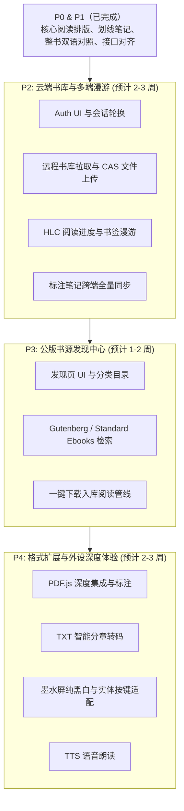

# HPF-Reader 后续演进路线图 (P2 / P3 / P4 Roadmap)

> 本文档记录在完成 **P0（核心阅读器排版与标注）** 和 **P1（整书双语对照翻译闭环与接口对齐）** 后，系统后续版本的优先级规划、架构设计与落地路线。

---

## 一、当前里程碑完成情况 (P0 / P1 / P2 / P3 / P4)

| 模块 | 交付项 | 对应代码与契约 | 状态 |
|---|---|---|---|
| **P0 基础排版与交互** | 字体（宋体/黑体/楷体/系统）、字号、行高、边距、首行缩进、主题切换 | `ReaderSettingsPopover.vue` / `settings.ts` / `readerStyles.ts` | ✅ 已完成并落盘 |
| **P0 翻页与手势** | 左右 25% 触控翻页、中间 50% 切换沉浸模式、底部进度条 | `bridge.ts` / `ReaderView.vue` (`reader-footer`) | ✅ 已完成 |
| **P0 标注与高亮系统** | 4色高亮+下划线、写想法、Foliate Overlayer 渲染、侧栏目录/标注 Tab、跳转 CFI、删除 | `useAnnotations` / `annotationStore.ts` / `useFoliateEngine.ts` | ✅ 已完成并带本地离线支持 |
| **P1 翻译数据链路** | 后端新增 `GET /v1/ai/jobs` 与 `GET /v1/ai/jobs/{jobId}/chunks` | `api/openapi.yaml` / `server/internal/httpapi/ai.go` | ✅ OpenAPI 校验与单元测试通过 |
| **P1 双语与译文阅读** | 双语分栏对照、单栏仅看译文、分章节过滤、跳转对应章节、导出 Markdown | `BilingualView.vue` / `BookTranslatePanel.vue` | ✅ 已完成 |
| **P2 账户与云端书库同步** | 登录/注册 AuthModal、`useAuthStore` 状态机、多设备状态、书籍云端上传与去重、标注实时同步 | `AuthModal.vue` / `auth.ts` / `AppShell.vue` / `LibraryView.vue` | ✅ 已完成 |
| **P3 公版书源发现中心** | `GET /v1/sources` & `/search` 契约打通、分类精选（奥斯汀/科幻/哲学等）、一键入库并阅读 | `DiscoverView.vue` / `createSourcesApi` / `router.ts` | ✅ 已完成 |
| **P4 格式扩展与外设深度适配** | TXT 智能分章与纯客户端 EPUB 转码、墨水屏（E-ink）零残影无动画高对比度、物理按键（音量键/翻页键）拦截映射、TTS 语音朗读浮条 | `txtParser.ts` / `TtsPlayer.vue` / `useTts.ts` / `readerStyles.ts` | ✅ 已完成 |
| **构建与质量保证** | 全栈一键构建脚本、OpenAPI 校验、160 前端单测、全套后端单测、桌面/服务端可执行文件打包 | `scripts/build-all.ps1` / `vitest` / `go test` | ✅ 100% 验证通过 |

---

## 二、P2 优先级：云端书库与多端同步 (Cloud Library & Multi-Device Sync)

### 2.1 业务背景
HPF-Reader 定位为自托管、本地优先的全平台阅读器。当前客户端已具备完整的本地存储和离线能力，服务端已具备 `/v1/auth/*`、`/v1/books/*`、`/v1/sync/*` 与 `/v1/books/{id}/file` 接口。P2 的核心是将客户端与服务端全面联通，实现多设备（桌面、移动端、Web）间的书籍与阅读状态无缝漫游。

### 2.2 详细交付任务

#### 1. 账户系统与登录界面 (Auth UI)
- **前端页面**：在设置页或主界面右上角增加「登录 / 注册 / 用户中心」弹窗与卡片。
- **会话持久化**：使用已实现的 `AuthSession`（位于 `src/features/sync/session.ts`），将 access token 存入内存，refresh token 存入持久存储。
- **无感刷新与重用检测**：严格对齐服务端轮换策略，当 access token 过期（401）时自动调用 `/v1/auth/refresh` 获取新令牌对，防止用户被频繁踢下线。

#### 2. 云端书库列表与双向同步
- **远程书库拉取**：客户端书库（`LibraryView.vue`）支持「本地书架」与「云端书架」视图切换或无缝聚合。
- **书籍文件上传与去重**：
  - 导入本地 EPUB 时计算 SHA-256 哈希；
  - 调用 `POST /v1/books` 创建元数据；
  - 调用 `PUT /v1/books/{id}/file?contentHash=sha256:...` 上传文件二进制流；
  - 服务端复核 hash 并在存储层做内容寻址（CAS）去重，避免重复占用 MinIO/本地磁盘。
- **封面离线提取与云端缓存**：客户端在导入时提取 EPUB 封面并生成 WebP 缩略图；云端异步提取封面提供 `/v1/books/{id}/cover` 接口。

#### 3. 阅读进度与状态同步 (Sync Engine)
- **HLC 混合逻辑时钟**：采用现有的 HLC 算法（服务端 `internal/sync` 与客户端 `features/sync`），确保离线状态下的多设备修改能基于因果顺序合并。
- **Readium Locator 进度同步**：
  - 同步内容：`progression`、`totalProgression`、`fragments: [cfi]`；
  - 触发策略：页面停留超过 5 秒、翻页、退至后台或关闭阅读器时防抖推送（Debounce 3s）；
  - 冲突处理：按 HLC 时钟最后修改胜出（LWW），若存在进度分歧提示用户「在另一台设备读到 XX%，是否跳转？」。

#### 4. 标注与笔记跨端同步
- 将当前 `useAnnotations` 本地存储的 `hpf.annotations.v1.<bookId>` 与后端的 `/v1/books/{id}/annotations` 及 `/v1/sync/push` 完全接入，离线标注放入待推送队列，恢复联网后统一推送到服务端并在其他设备 pull 同步。

---

## 三、P3 优先级：公版书源 (OPDS) 发现中心 (Discovery Center)

### 3.1 业务背景
为了让用户在不自行寻找书籍文件的情况下即可立即开始阅读，服务端已在 `apps/server/internal/sources` 实现了针对 Project Gutenberg（古登堡计划）与 Standard Ebooks 等公版书源的检索与抓取，并具备严格的 SSRF 与 DNS 重绑定防护。P3 将在前端构建「发现 (Discover)」视图。

### 3.2 详细交付任务

#### 1. 发现中心界面 (DiscoverView)
- **导航入口**：在左侧/底部导航栏加入「发现」Tab。
- **书源切换**：支持古登堡（Gutenberg）与 Standard Ebooks 分类切换。
- **精选推荐与分类排行榜**：经典文学、哲学、历史、科幻等分类标签与热门榜单浏览。
- **全局搜索**：输入作者名或书名，向服务端 `GET /v1/sources/search?q=...` 发起请求，展示匹配结果列表（包含标题、作者、语言、封面、简介）。

#### 2. 一键导入与缓存流程
- 用户点击「入库并阅读」后：
  1. 前端向后端下发入库指令；
  2. 后端服务端在后台下载公版 EPUB，校验 MIME 类型与文件完整性；
  3. 后端自动入库并返回生成的 `bookId`；
  4. 前端直接无缝跳转至该书的 `ReaderView`，启动排版渲染。

#### 3. 自定义 OPDS 源支持
- 允许高级用户在设置中添加自定义 OPDS 书源（如私人 Calibre 书库），输入 OPDS 目录 URL 与 Basic Auth 凭据，前端解析 OPDS XML/JSON Feed 格式进行聚合展示。

---

## 四、P4 优先级：格式扩展与硬件深度适配 (Formats & Hardware Adaptations)

### 4.1 格式扩展支持

#### 1. PDF 深度支持
- **当前现状**：`foliate-js/pdf.js` 基于 PDF.js，但现有工程主要验证了 EPUB 流程。
- **落地路线**：
  - 针对 PDF 格式，接入 PDF.js 渲染管线，实现双页/单页适合宽度、连续滚动（Scroll mode）与单页缩放；
  - 支持 PDF 目录（TOC/Outline）解析；
  - 支持文本层（TextLayer）划词翻译与高亮标注。

#### 2. TXT / MOBI / AZW3 支持
- **TXT 智能排版**：对 TXT 文本利用正则自动探测章节目录（如 `第[0-9一二三四五六七八九十百]+章`），在客户端或服务端轻量转换为标准 EPUB 结构后交由 Foliate 渲染。
- **MOBI / AZW3 支持**：通过 vendored mobi 解析器或者在 Go 服务端利用原生库转换为 EPUB 供客户端阅读。

### 4.2 墨水屏（E-ink）与实体按键深度适配
- **黑白高对比度模式**：在现有 `'ink'` 主题基础上，提供 0 灰色、纯黑纯白、无任何渐变或阴影的墨水屏专用 UI。
- **动画禁用 (Zero Animation)**：墨水屏模式下一键关闭所有 CSS transition 与 transform 动画，翻页直接无动画切屏，防止屏幕频繁重绘与残影。
- **硬件翻页键监听**：
  - 针对带有物理翻页键的电纸书（如文石、掌阅、Kindle 移植设备等），在 Wails 桌面端和 Android 移动端拦截 `VolumeUp` / `VolumeDown` / `PageUp` / `PageDown` 键码，直接映射为翻页动作。
- **主动全屏刷新 (A2 / Regal Refresh)**：翻页 N 次后触发一次屏幕闪烁刷新以清除电墨水残影。

### 4.3 离线与系统级 TTS (Text-to-Speech)
- 接入移动端与桌面端的系统内置 TTS 语音引擎（Web Speech API 或平台原生能力）；
- 跟随阅读进度高亮当前朗读句子并支持自动翻页。

---

## 五、版本演进甘特与阶段里程碑

