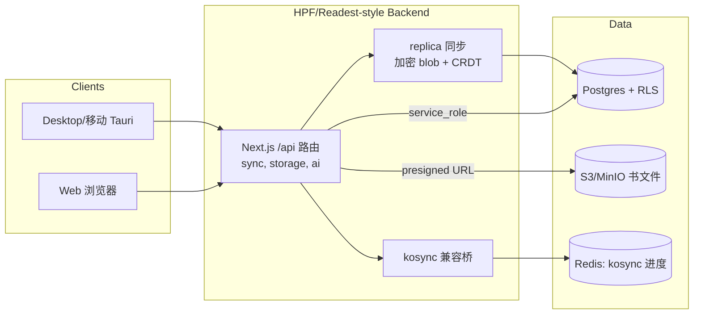

# HPF-Reader 后端、同步协议与多用户架构调研

> 调研员:backend-research(团队 task-2) · 调研日期:**2026-11-02** · 交付路径:docs/research/20-backend-sync.md
> 证据规则:每条关键结论后附来源链接与访问日期;凡本次未抓到一手原文的,统一标注 **未验证**,不臆测仓库名、字段名或数字。
> 本文只做设计与调研,不含业务代码;SQL/JSON/伪代码均为**设计草案**,不是可执行实现。

---

## 0. 结论速览(TL;DR)

| # | 结论 | 强度 |
|---|------|------|
| 1 | **不存在公开的 readest-supabase 仓库**;Readest 的同步后端实际在 readest/readest 主仓库内(docker/volumes/db + src/pages/api/sync* + src/libs/replicaSync*)。参照时应以此为准 | 已核实(2026-11-02) |
| 2 | Readest 的服务端栈 = **Supabase 全家桶(Postgres + GoTrue + PostgREST + Kong)+ MinIO**,单机 5 容器;自托管默认每用户存储配额 1 GiB | 已核实 |
| 3 | Readest 的进度表只有 4 张:books / book_configs / book_notes / files;进度存在 books.progress(integer[]) 与 book_configs.progress(jsonb)+ location/xpointer(CFI) | 已核实 |
| 4 | 冲突解决已从"整个 updated_at LWW"进化到 **HLC 字段级 LWW + remove-wins 墓碑 + 服务端合并函数**(crdt_merge_replica),可直接抄 | 已核实 |
| 5 | **增量游标必须由服务端分配**(Readest 用 books.synced_at 触发器),不能用客户端 updated_at 当游标,否则合并过的行不会传播(issue #4678) | 已核实 |
| 6 | KOReader kosync 协议极简:3 个端点、5 个字段、document = 文件 MD5;但**语义坑极多**(未知文档要 200 {};错误码非 401 会导致客户端重试 4 周) | 已核实 |
| 7 | Readium Locator 是当前最合适的**跨格式定位序列化标准**(href+type+locations{fragments,progression,position,totalProgression}+text{after,before,highlight}),应作为 HPF 的 location 主格式 | 已核实(规范原文) |
| 8 | 推荐技术栈:**TypeScript(NestJS/Fastify)+ Postgres 16 + S3/MinIO + Redis**,自研同步引擎;**否决** v1 直接套 Supabase 自托管(运维面过大);**否决** Python/FastAPI 作为唯一后端(仅保留为 LLM 侧车) | 建议(论证见 §7) |
| 9 | 成本:1k 用户量级可在单台 4C8G + 200GB 盘跑通;10k 用户才需要拆对象存储与只读副本。价格数字本次未核实官方页面 → **未验证** | 推算 |

---

## 1. 核实点:Readest 的同步后端到底在哪里

### 1.1 关于 "readest-supabase" 的核实结论

任务书要求核实 "readest-supabase 仓库(表结构、认证方式、进度同步粒度、冲突处理)"。本次核实的结论是:

| 检查项 | 方法 | 结果 |
|--------|------|------|
| readest 组织下是否存在 readest-supabase | GitHub REST:`GET /orgs/readest/repos` | 13 个公开仓库(turso、tauri、foliate-js、readest、tauri-plugin-turso、readest.koplugin 相关等),**无 readest-supabase** |
| 直接访问 readest/readest-supabase | GitHub REST:`GET /repos/readest/readest-supabase/contents/` | **404 Not Found** |
| GitHub 仓库搜索 readest-supabase | GitHub REST:`GET /search/repositories?q=readest-supabase` | 仅返回第三方二开仓库(cshdotcom/readest-lite),非官方 |
| 是否存在等价的公开同步后端 | 遍历 readest/readest 的 git tree(5261 个路径) | 同步后端以 **docker/volumes/db/***(SQL)+ **apps/readest-app/src/pages/api/sync*** + **src/libs/replicaSync*** 形式内联在主仓库 |

> 来源:<https://api.github.com/orgs/readest/repos>(访问 2026-11-02,readest 仓库 25,854 stars,最近 push 2026-11-02T10:33:50Z);
> <https://github.com/readest/readest>(访问 2026-11-02)。
> **结论:凡引用 "readest-supabase 的表结构" 的说法都应视为不可靠;本文以下所有 Readest 结论均来自主仓库一手文件。**

### 1.2 一手证据链(建议据此复核)

| 主题 | 文件(主仓库路径) | 本次读取内容 |
|------|------------------|--------------|
| 基础表结构 | docker/volumes/db/init/schema.sql | books / book_configs / book_notes / files + RLS 策略 |
| 同步/CRDT 迁移 | docker/volumes/db/migrations/003_add_replicas.sql、004_crdt_merge_replica_fn.sql | replicas / replica_keys 表、hlc_max、crdt_merge_fields、crdt_merge_replica |
| 自托管栈 | docker/compose.yaml、docker/README.md、docker/.env.example | 5 服务拓扑、端口、环境变量、配额默认值 |
| 系统架构 | apps/readest-app/docs/architecture.md | 三条同步路径、API 路由清单、云书库 |
| 客户端同步协议 | apps/readest-app/src/libs/sync.ts | GET/POST /sync 的 since/type/book/meta_hash/limit 参数与载荷 |
| KOReader 兼容 | src/services/sync/KOSyncClient.ts、src/pages/api/kosync.ts | kosync 字段、鉴权头、端点白名单 |
| 生产踩坑记录 | apps/readest-app/.claude/memory/*.md | 签名密钥迁移、退出 Supabase 计划、游标不变量 |

> 说明:`.claude/memory/*.md` 是该仓库内的工程笔记(随代码公开),属于**项目自述**,不是官方文档;引用时按"项目内证据"标注。

### 1.3 自托管栈(Supabase 全家桶 + MinIO)

| 角色 | 镜像 | 端口 | 备注 |
|------|------|------|------|
| client | ghcr.io/readest/readest | 3000 | Next.js 客户端/服务端路由同体 |
| db | supabase/postgres:15.8.1.085 | - | 带 Supabase 扩展的 Postgres |
| kong | kong:2.8.1 | 8000 | API 网关,路由 /auth/v1、/rest/v1 |
| auth | supabase/gotrue:v2.185.0 | - | 邮箱注册、JWT、SMTP |
| rest | postgrest/postgrest:v14.3 | - | 直接把表暴露成 REST,靠 RLS 隔离 |
| minio | quay.io/minio/minio | 9000/9001 | 书文件、封面 |
| minio-setup | quay.io/minio/mc | - | 建桶 |

来源:<https://github.com/readest/readest/blob/main/docker/README.md>、<https://github.com/readest/readest/blob/main/docker/compose.yaml>(访问 2026-11-02)。

值得抄的两个工程细节:

1. **单镜像 + 运行时配置**:`/runtime-config.js` 由服务端注入 supabaseUrl / anonKey / apiBaseUrl / objectStorageType / storageFixedQuota / translationFixedQuota,因此同一个镜像可部署到任意域名与 Supabase 项目,不需要重建(architecture.md §5.4)。
2. **迁移脚本自己管**:容器首次启动才跑 init,升级镜像不会跑迁移;README 明确要求升级后手动执行 `docker compose exec db /docker-entrypoint-initdb.d/zz-readest-migrations.sh`,并用 `readest_meta.migrations` 表记录已应用文件名。这是**反面教材**:HPF-Reader 必须用独立 migration runner(迁移与镜像解耦)。

### 1.4 后端与同步数据流(据 architecture.md 重绘)



> 说明:Redis 那一层是 **KOReader 官方 sync server** 的实现细节(见 §3.2),Readest 的 kosync 是"代理到用户自建 kosync 服务器",两者不要混为一谈。Readest 的 kosync.ts 只做代理白名单,不存进度。

---

## 2. Readest 的数据模型与同步机制(逐条核实)

### 2.1 四张基表

| 表 | 主键 | 关键字段 | 用途 |
|----|------|----------|------|
| books | (user_id, book_hash) | meta_hash, format, title, author, tags[], **progress integer[]**, reading_status, reading_status_updated_at, cover_hash, page_count, metadata json, **synced_at**, updated_at, deleted_at | 书库元数据 + 进度数组 |
| book_configs | (user_id, book_hash) | **location**(CFI 字符串), **xpointer**, **progress jsonb**, view_settings, search_config, rsvp_position, tts_packs, updated_at, deleted_at | 每本书的阅读位置与排版设置 |
| book_notes | (user_id, book_hash, id) | type, cfi, xpointer0, xpointer1, text, style, color, note, page, global, ink jsonb, updated_at, deleted_at | 高亮/笔记/手写(ink) |
| files | id uuid (file_key unique) | user_id, book_hash, file_key, file_size | 对象存储中的文件登记 |

三个可直接借鉴的设计:

1. **业务主键是"内容哈希"而不是自增 ID**:书用 md5/sha 哈希做主键的一部分,天然支持多设备去重与"同一本书"识别。
2. **进度双轨**:books.progress 是"阅读百分比/页数组"(跨设备对齐用,不依赖具体排版),book_configs.location 是"可解析的精确位置"(CFI)。二者分工明确 —— 不同排版/不同文件字节的副本之间只能比百分比,不能比 CFI。
3. **软删除统一用 deleted_at**,同步靠墓碑传播删除。

来源:<https://github.com/readest/readest/blob/main/docker/volumes/db/init/schema.sql>(访问 2026-11-02)。

### 2.2 增量游标:synced_at 与 updated_at 必须分开

schema.sql 里有一段关键注释(原文摘要):

> "Server-assigned incremental-pull cursor, decoupled from updated_at (the client event time / sort key). A trigger stamps it on every write so a server-resolved merge propagates without reordering the date-read library. See migration 016_add_books_synced_at.sql (issue #4678)."

即:**updated_at 是客户端事件时间(用于排序/展示"最近在读"),synced_at 是服务端写入时间(用于增量拉取)**。若用同一个字段,服务端合并过的行不会获得新时间戳,其它设备就永远拉不到这次合并结果。触发器:

```sql
CREATE TRIGGER books_set_synced_at
  BEFORE INSERT OR UPDATE ON public.books
  FOR EACH ROW EXECUTE FUNCTION public.set_books_synced_at();  -- NEW.synced_at := now()
```

> HPF-Reader 落地建议:用**单调递增的 change_seq(bigint identity)** 或 (updated_at, seq) 复合游标,比时间戳更抗时钟漂移;Readest 的记忆笔记 `sync-synced-at-cursor-4678.md` 与 `sync-clock-skew-lastsynced-5661.md` 记录了同类问题。

### 2.3 RLS:每张表 4 条策略

```sql
ALTER TABLE public.books ENABLE ROW LEVEL SECURITY;
CREATE POLICY select_books ON public.books FOR SELECT TO authenticated
  USING ((SELECT auth.uid()) = user_id);
CREATE POLICY insert_books ON public.books FOR INSERT TO authenticated
  WITH CHECK ((SELECT auth.uid()) = user_id);
CREATE POLICY update_books ON public.books FOR UPDATE TO authenticated
  USING ((SELECT auth.uid()) = user_id);
CREATE POLICY delete_books ON public.books FOR DELETE TO authenticated
  USING ((SELECT auth.uid()) = user_id);
```

要点:**RLS 是最后一道防线,不是唯一防线**。Readest 的 /api 路由仍用 service_role 直连数据库(architecture.md §5.1:"DB access is already server-side only (API routes)"),RLS 主要防 PostgREST 直连越权。对 HPF-Reader:若自研 API 而不暴露 PostgREST,RLS 属于"纵深防御",仍建议保留(成本低)。

### 2.4 认证与签名密钥(生产实践)

| 事项 | 现状 | 启示 |
|------|------|------|
| 认证服务 | GoTrue(邮箱+密码、SMTP 确认、可选匿名用户) | HPF 自研认证时对标 GoTrue 的行为即可,不必自造协议 |
| JWT | 自托管用 HS256(ANON_KEY/SERVICE_ROLE_KEY 为 HS256 签名 JWT);生产已迁到自有 **ES256** 签名密钥,路由用 `getClaims()` + JWKS 缓存 10 分钟 | 早期就用非对称签名 + JWKS,**不要**把密钥烘进客户端 |
| 迁移风险 | 每次签名密钥状态变更都会重启 PostgREST,REST 出现数秒 503;两天内两次变更叠加造成约 1 分钟 503 | 密钥轮换要错峰、串行、可观测 |
| 托管绑定 | 项目笔记记录了"退出 Supabase"三步计划(改 project-ref URL → 自定义域 auth.readest.com → 自建 GoTrue),第 2-3 步 **ON HOLD** | Supabase 的锁定点在 **auth**,不在数据库;自研 API 可避开 |

来源:<https://github.com/readest/readest/blob/main/apps/readest-app/.claude/memory/supabase-signing-keys-migration-2026-10-12.md>、
<https://github.com/readest/readest/blob/main/apps/readest-app/.claude/memory/supabase-exit-host-migration.md>(均访问 2026-11-02,笔记修改时间 2026-10-12)。

### 2.5 三条并存的同步路径(Readest 现状)

| 路径 | 代码位置 | 传输内容 | 加密 | 适用 |
|------|----------|----------|------|------|
| 旧版 KOReader 兼容同步 | src/services/sync/KOSyncClient.ts + pages/api/sync.ts、kosync.ts | 仅阅读进度(单点) | 否 | 兼容 KOReader/第三方设备 |
| **replica 同步(现代路径)** | src/services/sync/replica*.ts + pages/api/sync/replicas.ts | 注释、设置、词典、字体、贴图、OPDS 目录等**用户资产** | **是**:口令派生密钥,本地加密后再上传 | 自有客户端之间 |
| 第三方文件同步 | src/services/sync/file/* + providers/(WebDAV/GoogleDrive/S3/OneDrive/iCloud) | library.json + 书文件 + 封面 + 每书配置 | 否(依赖 provider) | 无自建后端时的兜底 |

来源:<https://github.com/readest/readest/blob/main/apps/readest-app/docs/architecture.md> §6.1、§6.2。

> **产品启示**:Readest 同时维护三条路径,是历史包袱也是能力。HPF-Reader v1 **只做一条**:自研 replica 式同步(服务端 Postgres);kosync 兼容层作为"轻量适配器"后置;第三方 WebDAV/网盘同步列为 v2。

### 2.6 replica 表:字段级 LWW + HLC

003 迁移的表结构(节选,字段名逐字保留):

```sql
CREATE TABLE public.replicas (
  user_id        uuid NOT NULL,
  kind           text NOT NULL,          -- 服务端白名单 CHECK (kind IN ('dictionary'))
  replica_id     text NOT NULL,
  fields_jsonb   jsonb NOT NULL DEFAULT '{}',  -- {字段: {v: 值, t: HLC, s: deviceId}}
  manifest_jsonb jsonb,                  -- 二进制附件的清单;null = 附件未就绪
  deleted_at_ts  text,                   -- remove-wins 墓碑 HLC
  reincarnation  text,                   -- 重新导入令牌(复活为新逻辑身份)
  updated_at_ts  text NOT NULL,          -- max(字段 HLC, 墓碑 HLC),拉取游标
  schema_version integer NOT NULL DEFAULT 1,
  created_at timestamptz DEFAULT now(),
  modified_at timestamptz DEFAULT now(),
  PRIMARY KEY (user_id, kind, replica_id),
  CONSTRAINT replicas_fields_size CHECK (pg_column_size(fields_jsonb) <= 65536)
);
CREATE INDEX idx_replicas_pull_cursor ON public.replicas (user_id, kind, updated_at_ts);
```

004 迁移的合并语义(可直接照抄的规则):

| 规则 | 实现 | 效果 |
|------|------|------|
| 字段级 LWW | 比较 `envelope.t`(HLC 字符串,字典序即时间序),大者胜 | 不同设备改不同字段互不覆盖 |
| 同 HLC 决胜 | 比较 `envelope.s`(deviceId)字典序 | 结果确定、可复现 |
| remove-wins | `deleted_at_ts = hlc_max(local, remote)`;字段写入不复活墓碑 | 删除不会被慢设备"写回来" |
| 前向兼容 | 合并不丢弃未知字段;`schema_version = GREATEST(...)` | 旧客户端不破坏新字段 |
| 原子性 | `INSERT ... ON CONFLICT DO UPDATE` 单语句调用 `crdt_merge_replica()` | 并发推送不会 fetch-then-upsert 交错 |
| 权限 | 函数默认 SECURITY INVOKER,先断言 `auth.uid() = NEW.user_id` | 不能靠函数越权 |

来源:<https://github.com/readest/readest/blob/main/docker/volumes/db/migrations/003_add_replicas.sql>、
<https://github.com/readest/readest/blob/main/docker/volumes/db/migrations/004_crdt_merge_replica_fn.sql>(访问 2026-11-02)。

### 2.7 进度同步的粒度与"最远位置"语义

客户端实现(src/app/reader/hooks/useProgressSync.ts)读出的可验证事实:

| 行为 | 证据 |
|------|------|
| 进度变化后 **debounce 推送**(间隔常量 `SYNC_PROGRESS_INTERVAL_SEC`,具体数值本次未读取,**未验证**) | 第 205-207 行 `debounce(..., SYNC_PROGRESS_INTERVAL_SEC * 1000)` |
| 打开书时拉取一次,失败按 1.5s / 4s / 10s 重试 | 第 28 行 `PULL_RETRY_DELAYS_MS = [1500, 4000, 10000]` |
| 关闭书 / 手动同步时 **先 flush 待推送再拉取**(否则丢掉窗口内进度,issue #4532) | 第 233-251 行 |
| 应用切后台先 flush,回前台先拉取再允许自动推送 | 第 253-272 行 |
| **同文件**:CFI/xpointer 可直接使用;**不同字节的兄弟副本**:只允许贡献"百分比",且只能**向前**推进(epsilon 0.002) | 第 336-416 行 |
| 合并过期判断:`savedAt = max(localSavedAt, exactConfig.updatedAt)`,避免陈旧副本把主动回退拉回去 | 第 395-411 行 |
| 故意回退(rewind)必须能生效:只有当兄弟副本**更新时间更新**且百分比更大时才前移 | 同上 |

> 这段代码是整个调研里**最有价值的产品语义**:阅读进度不是纯 LWW,也不是纯 max。正确模型是:
> **(1) 同一文件内以时间戳新的位置为准(允许用户主动回退);(2) 跨文件副本只允许按百分比单调前移;(3) 墓碑/清理要单独处理,否则重新下载会回到旧位置。**

来源:<https://github.com/readest/readest/blob/main/apps/readest-app/src/app/reader/hooks/useProgressSync.ts>(访问 2026-11-02)。

### 2.8 Readest 的 /sync 接口形状

```http
GET /sync?since=<epoch_ms>&type=books|configs|notes|stats&book=<hash>&meta_hash=<hash>&limit=<n>
Authorization: Bearer <access_token>

200 OK
{ "books": [...], "configs": [...], "notes": [...], "statBooks": [...], "statPages": [...] }
```

```http
POST /sync
{ "books": [ {book_hash, title, author, progress, reading_status, updated_at, deleted_at, ...} ],
  "configs": [ {book_hash, location, xpointer, progress, view_settings, updated_at} ],
  "notes": [ {book_hash, id, type, cfi, xpointer0, xpointer1, text, note, updated_at, deleted_at} ] }
200 OK -> 同 GET 的 SyncResult(回传服务端裁决后的记录)
```

特点与缺陷:

- 优点:**一次请求批量推多类实体**,"推送即拉取"(POST 返回合并结果),弱网下省一个 RTT。
- 缺陷:**没有幂等键**,重试只能靠"LWW 天然幂等"兜底;notes 的 id 由客户端生成(好),但 stats 分页记录用 (book_hash,page) 复合语义(需服务端 upsert RPC,见 migrations/019)。
- 缺陷:**没有 per-record 版本号回传**,客户端只能靠 timestamp 判断是否被覆盖。

来源:<https://github.com/readest/readest/blob/main/apps/readest-app/src/libs/sync.ts>(访问 2026-11-02)。

---

## 3. 同步协议调研:Readium Locator 与 KOReader kosync

### 3.1 Readium Locator(推荐作为 HPF 的主定位格式)

规范原文要点(models/locators/README.md,访问 2026-11-02):

每个 locator **必须**含 `href` + `type`(资源 URI 与媒体类型,`href` 不得含 fragment);**可以**含 `title`、`locations`、`text`。

| 对象 | 字段 | 类型/格式 | 必填 |
|------|------|-----------|------|
| locator | href | URI | 是 |
| locator | type | Media Type | 是 |
| locator | title | String | 否 |
| locator | locations | Location Object | 否 |
| locator | text | Text Object | 否 |
| location | fragments | Array\<string\> | 否 |
| location | **progression** | Float 0..1(资源内进度) | 否 |
| location | **position** | Integer > 0(出版物内第几个"位置") | 否 |
| location | **totalProgression** | Float 0..1(全书进度) | 否 |
| text | after / before / highlight | String | 否 |

fragment 的媒体相关约定(规范原文表格):

| 规范 | 适用范围 | 示例 |
|------|----------|------|
| HTML(WHATWG) | HTML/XHTML | `id` |
| Media Fragment URI 1.0 | 音频/视频/图片 | `t=67`、`xywh=160,120,320,240` |
| RFC 3778(PDF) | PDF | `page=12`、`viewrect=50,50,640,480` |

规范给的三个例子(节选其一):

```json
{
  "href": "http://example.com/chapter1",
  "type": "text/html",
  "title": "Chapter 1",
  "locations": { "position": 4, "progression": 0.03401, "totalProgression": 0.01349 },
  "text": { "after": "It is a truth universally acknowledged, ..." }
}
```

**对 HPF-Reader 的用法**:

| 需求 | Locator 表达 | 备注 |
|------|--------------|------|
| EPUB 精确位置 | `href=EPUB 内部 XHTML`, `locations.fragments=["epubcfi(...)"]` 或 HTML 扩展的 CSS 选择器 | HTML 扩展文档本次**未抓到原文**(未验证字段名),建议仅用 fragments 存 CFI/xpointer 字符串 |
| TXT | `href=file.txt`, `progression` + `text.before/highlight` 锚定 | TXT 无稳定 DOM,必须文本锚定 |
| PDF | `href=doc.pdf`, `fragments=["page=12","viewrect=..."]` | 直接用 PDF fragment |
| 有声书 | `fragments=["t=389.84"]` | 与 EPUB Media Overlays 对齐 |
| 跨文件副本对齐 | 只比 `totalProgression` | 与 Readest 的"sibling 只贡献百分比"一致 |

> 建议:**库里存 locator JSON 原文**(jsonb),同时把 `totalProgression` 与 `position` 抽成生成列建索引,用于"最远位置""书架进度条"这类查询,避免每次解析 JSON。
> JSON Schema 参考:<https://github.com/readium/architecture/tree/master/schema/locator.schema.json>(链接存在;本次抓取该文件失败,**内容未验证**)。

### 3.2 KOReader kosync 协议(事实 + 坑)

kosync 是事实标准但**长期无规范**。第三方 conformance 项目(测量日期 **2026-09-21**)对官方实现跑 49 项 MUST:0 失败;并指出至少 9 个独立重实现互不兼容。

#### 3.2.1 端点与鉴权

| 方法 | 路径 | 请求 | 说明 |
|------|------|------|------|
| GET | /healthcheck | - | 返回 `{"state":"OK"}` |
| POST | /users/create | `{"username": "...", "password": "<MD5>"}` | **password 已是 MD5**,服务端不得再哈希 |
| GET | /users/auth | 头 `X-Auth-User` + `X-Auth-Key`(=MD5(密码)) | 成功返回 `{"authorized":"OK"}` |
| PUT | /syncs/progress | 见下 | 写进度 |
| GET | /syncs/progress/{document} | - | 读进度 |
| DELETE | /users/me | 同上鉴权头 | 删号(官方 README) |
| PUT | /users/password | `{"password":"<新 MD5>"}` | 改密(官方 README) |

请求头必须带 `Accept: application/vnd.koreader.v1+json`(参考实现强制要求);**响应是 application/json**,不是 vendor 类型。

#### 3.2.2 字段(逐字段核对 Readest 实现 + conformance 文档)

| 字段 | 出现处 | 类型 | 语义 |
|------|--------|------|------|
| document | PUT body / GET path | string(32 hex) | 文档 MD5,客户端计算;采样算法取 12 段(首偏移 0,i = -1..10),实现错就同步不了 |
| progress | PUT body / GET resp | string | 位置字符串,KOReader 用 XPath/`/body/DocFragment[20]/body/p[22]/img.0`;Readest 存 CFI/xpointer |
| percentage | PUT body / GET resp | float 0..1 | 全书百分比 |
| device | PUT body / GET resp | string | 设备名(人类可读) |
| device_id | PUT body / GET resp | string | 设备唯一 ID |
| timestamp | GET resp | number | 服务端时间戳;**缺失会反转客户端同步策略** |
| metadata(可选扩展) | PUT body | object | `{filename,title,authors}`,KOReader 2026.05+ 的"发送文档元数据",官方服务端忽略 |

PUT 示例(据 Readest KOSyncClient 实现):

```json
{
  "document": "0b229176d4e8db7f6d2b5a4952368d7a",
  "progress": "epubcfi(/6/24!/4/2/2[c01]/1:58)",
  "percentage": 0.31879884821061,
  "device": "PocketBook",
  "device_id": "b7c2...",
  "metadata": { "filename": "三体.epub", "title": "三体", "authors": "刘慈欣" }
}
```

#### 3.2.3 必须知道的 6 个坑(直接影响 HPF 的兼容层设计)

| 坑 | 后果 | 对策 |
|----|------|------|
| 未知 document 应返回 **200 + 空对象**,不是 404 | 客户端判断"没有百分比字段"= 未读;404 会显示为同步错误 | 兼容层永远 200,空 `{}` |
| **password 已是 MD5**,再哈希则账号永久无法登录 | 账号锁死 | 存 `md5` 原值(或再包一层自己算法的 bcrypt,但校验输入必须先按 MD5 处理) |
| GET 响应**缺 timestamp** 会反转同步策略 | 新版位置在书中更靠前时被判为"向后",被静默丢弃 | 必返回 timestamp |
| 非 401 的失败会让客户端**重试 4 周** | 400/500 变成长达一个月的重试风暴 | 鉴权失败只回 401;其它错误尽量 4xx 且带 `code` |
| document id 允许任意字符但参考实现 GET 只路由 `[A-Za-z0-9_]+` | 含 `-` / `.` 的 id 写得进读不出 | 兼容层路由放宽 |
| 官方语义是"**最远进度**"而非"最后一次" | 与"允许主动回退"的现代语义冲突 | HPF 主模型用最后位置+显式 rewind;kosync 兼容层单独存"最远" |

来源:
<https://github.com/koreader/koreader-sync-server>(README,访问 2026-11-02,"keeps a record of the furthest reading progress");
<https://github.com/pid1/kosync-conformance>(README,访问 2026-11-02;测量日期 2026-09-21);
<https://github.com/readest/readest/blob/main/apps/readest-app/src/services/sync/KOSyncClient.ts>(访问 2026-11-02)。

### 3.3 同类产品的同步/权限模型对比

| 产品 | 同步内容 | 协议/存储 | 鉴权 | 多用户 | 一手来源 |
|------|----------|-----------|------|--------|----------|
| **Readest** | 进度、注释、设置、词典/字体等资产、书文件 | 自研 /sync(JSON)+ replica(加密 CRDT)+ kosync 兼容 + WebDAV/GDrive/S3/OneDrive/iCloud | Supabase GoTrue(JWT);第三方同步用各自 OAuth | 单用户账号(共享通过 @book_shares@ 迁移,细节未读) | 仓库(见 §1.2) |
| **KOReader** | 仅进度 | kosync(HTTP JSON) | X-Auth-User/Key | 单用户 | 官方 README |
| **Komga** | 阅读进度、书签、已读状态 | REST API + **KOReader Sync** + **Kobo Sync** | 账号 + 每库访问控制 | 多用户 + 每库 ACL + 年龄分级 | README |
| **Kavita** | 阅读进度、书签、EPUB 注释/高亮 | REST API + KOReader Sync(conformance 调查列明) | 角色权限 + **OIDC** | 多用户、角色、年龄限制 | README |
| **Calibre-Web** | Kobo 同步、阅读状态 | Kobo Sync 协议 + 自有 API | 本地账号 + LDAP/Google/GitHub OAuth/反向代理 + Magic Link | 细粒度 per-user 权限 | README |
| **Anx Reader**(Flutter,跨端) | 书、笔记、阅读进度 | **WebDAV** | WebDAV 凭据 | 未见多用户(未验证) | README |

> 规律:**开源阅读器的"同步"几乎都不是自建服务端**,而是"寄生在用户已有基础设施上"(WebDAV/S3/网盘)或"只同步进度"(kosync/Kobo)。真正做多用户+云书库的只有 Readest/Komga/Kavita/Calibre-Web。HPF-Reader 若要做"完整多用户 + Z-Library + LLM",必须自建后端 —— 这是与所有参照物的**结构性差异**,不要指望照抄。

### 3.4 可复用的协议设计要点(10 条)

1. **location 用 Readium Locator 作为唯一内部表示**,格式差异(CFI/xpointer/page/时间轴)全部塞进 `locations.fragments`。
2. **进度存两份**:精确 locator + 归一化 `totalProgression`;跨文件/跨排版只信归一化值。
3. **document 标识用内容哈希**(sha256 前 16 字节或完整),与 kosync 的 MD5 兼容层做映射表,不要改主键。
4. **增量拉取用服务端单调游标**,返回 `nextCursor` 与 `hasMore`;客户端只认服务端游标。
5. **推送要幂等**:每条变更带客户端生成的 `opId`(uuid)+ `deviceId` + `hlc`,服务端按 `(user_id, opId)` 去重。
6. **删除必须走墓碑**(deleted_at + HLC),并且"字段写入不复活墓碑"。
7. **合并逻辑要服务端与客户端同构**(Readest 把 PL/pgSQL 与 TS 两份实现对齐并写测试),否则两端会发散。
8. **兼容层隔离**:kosync / Kobo / OPDS 各自一个 adapter,内部统一到自家模型,不要污染主接口。
9. **错误码要稳定**:客户端按 code 分支,不按 message;鉴权失败只回 401。
10. **批量接口同时承担"推+拉"**(POST 返回合并结果),减少一次 RTT。

---

## 4. 同步策略设计(HPF-Reader)

### 4.1 数据分类与同步模型

| 数据类型 | 变更频率 | 冲突模型 | 传输 | 允许回退 | 备注 |
|----------|----------|----------|------|----------|------|
| 阅读进度(locator) | 高(每翻页) | **时间戳新的胜**,但跨副本百分比只前移 | 增量,debounce 10-30s | 是(显式 rewind 需带 flag) | 最热路径,必须批量+轻量 |
| 阅读状态(想读/在读/读完) | 低 | LWW | 随进度一起 | 是 | 与进度解耦 |
| 书签 | 中 | 增删集(LWW + 墓碑) | 增量 | 不适用 | id 客户端生成 |
| 高亮/笔记 | 中 | **字段级 LWW**(位置不可变,note/color 可变) | 增量 | 不适用 | text 与 locator 一旦写定不再改 |
| 手写 ink | 中 | 整体替换(单条记录 LWW) | 增量,blob 可外置 | 可 | 大对象走对象存储 |
| 排版/阅读设置 | 低 | **字段级 LWW + HLC** | 全量或增量 | 可 | 设备级覆盖(见 4.2) |
| 书架/分组/标签 | 低 | LWW + 墓碑 | 增量 | 可 | 集合语义用"成员行",不要存数组 |
| 书库元数据(标题/作者) | 低 | 字段级 LWW | 增量 | 可 | 手工编辑优先于自动抓取(需 origin 字段) |
| 书文件本体 | 极低 | 内容哈希去重,不可变 | 分片上传/预签名 | 不适用 | 不参与 CRDT |
| LLM 会话/翻译缓存 | 高 | 追加型(append-only) | 按需 | 不适用 | 可设备本地,减少隐私面 |

### 4.2 冲突解决选型对比

| 方案 | 适用 | 优点 | 缺点 | HPF 结论 |
|------|------|------|------|----------|
| 整体 LWW(行级 updated_at) | 简单元数据 | 实现 20 行 | 不同设备改不同字段会互相覆盖;时钟漂移即丢数据 | 仅用于低价值字段 |
| **字段级 LWW + HLC** | 进度/设置/注释 | 覆盖粒度细、无中心时钟依赖、服务端可裁决 | 需要 envelope 结构;字段多时体积涨 | **主方案**(抄 Readest) |
| 向量时钟 | 需要"检测并发"而非"自动合并" | 能报冲突给用户 | 体积随设备数线性增长;仍需人工裁决 | 仅用于"书库合并/冲突提示"场景 |
| CRDT 文本(Yjs/Automerge) | 协同编辑同一段文本 | 自动合并、支持离线 | 依赖重、存储膨胀、阅读场景几乎不需要同时编辑 | **不引入**;多人共读笔记可后置评估 |
| 服务端权威序列 | 强一致业务(配额/计费) | 简单可靠 | 离线不可写 | 用于账户/计费类 |

> 说明:Yjs / Automerge 的适用性判断基于其公开文档所述定位("CRDT for shared editing"),本次**未逐条核实其性能基准**,属工程判断。来源参考:<https://github.com/yjs/yjs>(访问 2026-11-02)。

### 4.3 HLC(Hybrid Logical Clock)格式草案

要求:字符串字典序 == 时间序(Readest 的 PL/pgSQL 直接 `a >= b` 比较),且能定位设备。

```text
<13 位毫秒时间戳>-<8 位十六进制计数器>-<设备ID前 8 位>
示例: 0192a3f4c1b0-0000000a-7f3c9d21
       ^物理时间(ms)  ^同毫秒内序号   ^deviceId 缩写
比较规则:先比时间戳,再比计数器,最后比设备 ID(字典序)
```

生成算法(伪代码):

```text
hlc.now():
  pt = max(wall_clock_ms, last_pt)          # 吸收时钟回拨
  if pt == last_pt: counter += 1
  else: counter = 0; last_pt = pt
  return format(pt, counter, device_id)

hlc.recv(remote_hlc):                        # 收到远端事件时
  pt = max(wall_clock_ms, last_pt, remote_pt)
  ...
```

### 4.4 增量同步与幂等(设计草案)

服务端维护一张变更日志 `sync_changes`(append-only),每行一个实体变更;客户端游标即 `seq`。

```text
PUSH /v1/sync/changes
  body: { deviceId, ops: [ {opId, entity, entityId, hlc, op: upsert|delete, payload} ] }
  事务内:
    for op in ops:
      if exists(user_id, op.opId): skip            # 幂等
      merged = merge(entity_row, op)               # 见 4.2 规则
      if merged.changed:
        seq = nextval('sync_seq')
        insert into sync_changes(user_id, seq, entity, entity_id, op, payload, hlc)
        upsert entity
      insert into sync_idempotency(user_id, opId, at)
  return { applied: n, skipped: m, serverTime, cursor: lastSeq }

PULL /v1/sync/changes?since=<seq>&limit=500
  return { changes: [...], nextCursor, hasMore }
```

要点:

1. **游标单调且服务端分配**:`sync_changes.seq` 用 `bigint generated always as identity`(全局)或每用户序列;客户端只回声 `nextCursor`。
2. **幂等键 `opId`**(uuid v7)保留 7 天即可(覆盖最长离线窗口);超出窗口的重复推送按 HLC 合并,结果仍收敛。
3. **分页拉取**必须支持 `limit` + `hasMore`;Readest 有过"1 万本书撑爆单次 /sync"的教训(见其 memory 中 sync-pull-10k-worker)。
4. **压缩**:超过 200 条变更时用 gzip;payload 用短字段名可省 30%+。
5. **一致性快照**:新设备首次同步走 `GET /v1/sync/snapshot`(返回全量 + cursor),避免从 0 拉历史。

### 4.5 离线优先与重试

| 环节 | 设计 |
|------|------|
| 本地写 | 先写本地 SQLite(Turso/libSQL),标 `dirty=1`,立即返回 UI |
| 队列 | 单一 FIFO + 合并同实体(后写覆盖前写,保留最大 HLC) |
| 触发 | 前台 10-30s debounce、切后台 flush、网络恢复、手动同步 |
| 重试 | 指数退避 1s→5s→30s→5min,上限 24h;**鉴权失败不重试**,转 refresh token |
| 顺序 | 同一实体按 HLC 升序发送;不同实体可并发 |
| 断电/崩溃 | opId 落盘,重启后重放;服务端幂等去重 |

### 4.6 多设备时钟与"最远阅读位置"

| 概念 | 定义 | 存储 | 用途 |
|------|------|------|------|
| current locator | 最后一次**用户主动**到达的位置 | reading_progress.locator | 打开书时恢复 |
| furthest locator | 历史最大 `totalProgression` 对应的 locator | reading_progress.furthest_locator | 书架进度、成就、统计 |
| rewind 标记 | 用户显式回退 | reading_progress.rewind_at + 目标 locator | 防止被"取最远"逻辑拉回 |

规则(综合 Readest 实践):

1. 同 `content_hash`:新时间戳胜,允许回退;回退需带 `explicit_rewind=true`,否则 10 分钟内可能被另一设备的"更远位置"覆盖。
2. 不同 `content_hash` 但同 `work_id`(同一本书的不同版本):只比较 `totalProgression`,且**只前移**。
3. 服务器时间与设备时间都不可信 → **合并裁决用 HLC**,展示用 updated_at。
4. 冲突提示:同一本书两台设备在 5 分钟内都大幅推进且差值 > 5%,前端提示"选择位置",不要静默丢弃。

### 4.7 数据量与带宽估算(标注:推算,非实测)

假设:人均 200 本书、50% 有进度;注释人均 300 条;每条 locator JSON ~400 B,注释 ~600 B。

| 项 | 公式 | 1k 用户 | 10k 用户 |
|----|------|---------|----------|
| 进度行 | 1000×200×0.5 | 100k 行 ≈ 60 MB | 1M 行 ≈ 600 MB |
| 注释行 | 1000×300 | 300k 行 ≈ 220 MB | 3M 行 ≈ 2.2 GB |
| 书文件 | 1000×200×3 MB | 600 GB | 6 TB |
| 封面 | 1000×200×80 KB | 16 GB | 160 GB |
| 变更日志(30 天) | 日活 30% × 40 次推送 × 1 KB × 30 | ≈ 360 MB | ≈ 3.6 GB |
| 同步带宽/日 | 日活设备 × 40 次 × (1 KB 上行 + 2 KB 下行) | ≈ 36 MB/日 | ≈ 360 MB/日 |

> 结论:**元数据同步在 10k 用户量级对 Postgres 完全无压力**(GB 级);真正的成本在**书文件存储与出网流量**。因此架构重点应从"同步 QPS"转向"存储分层 + 预签名直传 + 去重 + 按需下载"。
> 上述数字为设计假设推算,**未做压测**,标 **未验证**。

---

## 5. 多用户与权限

### 5.1 账号体系

| 能力 | v1 建议 | 依据/说明 |
|------|---------|-----------|
| 邮箱 + 密码 | 必做;bcrypt 哈希(bcrypt 作为兼容备选);邮箱验证可选(自托管默认关) | GoTrue 支持关闭自动确认,Readest 自托管用 `ENABLE_EMAIL_AUTOCONFIRM` 控制 |
| OAuth | v1.1:Google/GitHub/Apple(移动端上架需要 Apple) | Readest 生产用 Supabase OAuth;Calibre-Web 提供 Google/GitHub OAuth |
| OIDC 企业登录 | v2(Kavita 有 OIDC,可作为参照) | Kavita README |
| 2FA/TOTP | v1.1(推荐);恢复码 10 个 | GoTrue 有 MFA 能力,自研需自己实现 TOTP(RFC 6238) |
| Magic Link / 设备码 | v2(阅读器在电视/墨水屏上输入密码很痛苦) | Calibre-Web 的 "Magic Link login for eReaders" 是很好的先例 |
| 匿名/游客 | 建议支持(先读书后注册),但需合并账号策略 | Readest 自托管有 `ENABLE_ANONYMOUS_USERS` |
| 账号合并 | 必做(匿名→注册、OAuth→邮箱) | Readest 有 merge-accounts.mjs 脚本 |

### 5.2 会话与 JWT

| 项 | 建议 |
|----|------|
| Access Token | JWT,15 分钟,ES256 非对称签名,`kid` 头 |
| Refresh Token | 不透明随机串,存哈希,30-90 天,单次使用 + 轮换(rotation);设备维度可吊销 |
| 校验 | 网关/API 用本地公钥验签(不查库),JWKS 缓存 10 分钟(Readest 生产做法) |
| 吊销 | `token_version` 或 jti 黑名单(Redis,TTL=access 有效期) |
| 设备管理 | `devices` 表 + "退出全部设备" |
| CORS | 显式白名单,`Vary: Origin` |

### 5.3 多租户隔离策略对比

| 策略 | 隔离强度 | 运维成本 | 迁移成本 | 适用 |
|------|----------|----------|----------|------|
| 共享表 + `user_id` + 应用层过滤 | 中 | 低 | 低 | 内部/<100 用户 |
| **共享表 + RLS(Postgres)** | 中高 | 低(策略即代码) | 低 | **推荐**:HPF 默认 |
| 每用户 schema | 高 | 中(迁移要遍历) | 中 | 强隔离 SaaS |
| 每租户独立库 | 最高 | 高(连接池/备份/迁移爆炸) | 高 | 企业/合规客户 |

建议:**共享表 + user_id + RLS 作为默认**;对"家庭共享/团队书库"引入 `library_id` 维度,RLS 策略写成:
`USING (user_id = current_setting('app.user_id')::uuid OR library_id IN (SELECT library_id FROM library_members WHERE user_id = ...))`。
注意:直接用 `auth.uid()` 那种 Supabase 函数会把你绑死在 Supabase;自研请用会话变量 `SET LOCAL app.user_id`。

### 5.4 共享书库 / 家庭共享

| 模型 | 说明 | 数据设计 |
|------|------|----------|
| 私有书库 | 默认,每人一个 | library.kind='personal' |
| 家庭/团队书库 | 成员共享书与元数据,进度**各自独立** | library_members(role: owner/member),reading_progress 仍按 user_id |
| 单本分享 | 分享链接只读渲染(Readest 有 @share/*@ 路由) | share_tokens(token_hash, book_id, expires_at, max_views) |
| 公共书库 | 管理员导入,Z-Library 拉取结果 | library.kind='public' + 配额与审核 |

**关键**:共享的是"内容",不是"进度"。进度永远个人维度,否则家庭共享会互相覆盖阅读位置。

### 5.5 配额与审计

| 配额 | 默认 | 计量 | 超限行为 |
|------|------|------|----------|
| 存储 | 1 GiB/用户(与 Readest 默认一致) | files.file_size 汇总(物化视图或 Redis 计数) | 拒上传 413,前端提示清理 |
| 单文件 | 200 MB | 上传前预签名时校验 content-length | 拒绝 |
| LLM 调用 | 50k tokens/月(或按套餐) | llm_usage 表 + 日聚合 | 降级到本地模型/拒绝 |
| 书库数量 | 10/用户 | 计数 | 拒绝 |
| 同步频率 | 60 次/分钟/设备 | 令牌桶(Redis) | 429 + Retry-After |
| 并发上传 | 3 | 连接计数 | 429 |

审计事件(append-only):登录成功/失败、密码修改、2FA 变更、token 吊销、账号删除、书库成员变更、管理员操作、批量导出。保留 180 天,写 `audit_log` 并每日归档到对象存储。

---

## 6. 存储设计

### 6.1 书文件:对象存储 vs 本地磁盘

| 维度 | 本地磁盘(ext4/ZFS) | S3/MinIO |
|------|--------------------|----------|
| 单机起步 | 简单,零额外组件 | 需多一个容器(MinIO) |
| 水平扩展 | 需 NFS/共享卷,易成瓶颈 | 原生支持 |
| 预签名直传(客户端直传) | 需自写上传端点,占应用带宽 | 原生支持,应用只发签名 |
| 断点续传/分片 | 自己实现 | 原生 multipart |
| 备份 | rsync/snapshot | 版本化 + 跨区复制 |
| 成本 | 盘价 | 按 GB 计费(价格未核实) |

**建议**:接口抽象成 `ObjectStore`(put/get/presign/delete/stat),v1 实现两个驱动:`local`(单机,挂载卷)与 `s3`(MinIO/R2/B2)。客户端**一律走预签名直传**,应用服务器不中继字节流。Readest 已验证这条路(storage/upload.ts 发预签名 URL,S3_PUBLIC_ENDPOINT 与内部 endpoint 分离)。

### 6.2 去重

| 层级 | 键 | 说明 |
|------|----|------|
| 字节级 | `sha256(文件)` | 全局唯一;同哈希只存一份(跨用户去重需注意隐私,见下) |
| 逻辑书 | `work_id`(标题+作者规范化 + 可选 ISBN) | 同一本书的不同版本/不同来源 |
| 封面 | `sha256(封面图)` | 单独去重,常被多版本复用 |

隐私提醒:**跨用户字节去重会泄露"某人也有这本书"**。建议默认**按用户去重**,仅管理员公共书库做全局去重;或做"哈希加盐 per-user"的方案(代价是无法跨用户去重)。

### 6.3 封面与缩略图

| 尺寸 | 用途 | 格式 |
|------|------|------|
| 原始 | 详情页 | 保持源格式(webp 优先) |
| 512w | 网格 | webp q=80 |
| 128w | 列表/侧栏 | webp q=75 |
| 32w | 通知/图标 | webp |

生成放**队列**(异步),失败不影响导入;封面 URL 带 `cover_version`(Readest 有 @017_add_book_cover_version.sql@,用于 CDN 缓存失效)。

### 6.4 全文索引

| 方案 | 中文分词 | 运维 | 增量更新 | 适合 |
|------|----------|------|----------|------|
| Postgres FTS(tsvector + GIN) | 需 zhparser/pg_jieba 扩展 | **零额外组件** | 触发器/应用更新 | v1 首选(书内搜索 + 书库搜索) |
| Meilisearch | 内置中文分词较好 | 一个容器 | 近实时 | v1.1 书库级搜索体验 |
| Elasticsearch/OpenSearch | 最强(同义词/高亮/聚合) | JVM + 内存大户 | 近实时 | 10 万+ 书 / 企业 |

建议:**v1 只用 Postgres FTS**,索引**章节级文本**(不是全书一整块),字段:book_id, chapter_index, content, tsv;查询用 `websearch_to_tsquery` + 书名加权。书内定位仍靠 locator(搜索命中返回 locator,而不是偏移量)。是否引入 Meilisearch 留到"搜索体验被投诉"时再评估。

来源:Postgres 全文检索官方文档 <https://www.postgresql.org/docs/current/textsearch.html>(访问 2026-11-02,本次仅确认链接可达);Meilisearch 文档 <https://www.meilisearch.com/docs>(**未核实中文分词具体表现**)。

---

## 7. 技术栈横评

### 7.1 三个候选组合

| 维度 | A. TypeScript 全栈(NestJS/Fastify + Drizzle/Prisma) | B. Go(chi/echo + sqlc) | C. Python(FastAPI + SQLAlchemy) | D. Supabase 自托管(Readest 同款) |
|------|------------------------------------------------------|------------------------|----------------------------------|-----------------------------------|
| 与前端同语言 | ✅ 全栈 TS,类型共享(zod schema 可复用) | ❌ 需 OpenAPI 生成 | ❌ 需生成 | ✅(前端仍 TS) |
| 冷启动/内存 | 中(Node ~150-250 MB/实例) | ✅ 低(~30-60 MB) | 中高(~200-400 MB) | 高(5 容器 + JVM 无关但组件多) |
| 同步/CRDT 实现难度 | 低(与客户端同构逻辑可共享) | 中 | 中 | 低(但被 Supabase 约束) |
| LLM/RAG 生态 | 中(Vercel AI SDK 可用) | 中 | ✅ 最好 | 中 |
| 团队上手 | ✅ 若已有前端 TS 能力 | 需 Go 经验 | 需 Python 工程规范 | 需 Supabase 运维经验 |
| 运维复杂度 | 低(1-2 容器) | ✅ 最低(单二进制) | 中 | **高**(db/kong/auth/rest/minio 5+ 组件) |
| 水平扩展 | 无状态,易 | ✅ 最易 | 中 | 中(PostgREST/GoTrue 都是有状态边界) |
| 风险 | Node 生态依赖多、供应链噪音 | 招人/生态 | GIL 下 CPU 密集任务需另起 worker | **被 Supabase 版本与安全策略绑定**(Readest 正在计划迁出) |

### 7.2 各层选型建议

| 层 | 建议 | 备选 | 理由 |
|----|------|------|------|
| 运行时 | Node 22 LTS + NestJS(或 Fastify + 轻量分层) | Go | 与前端共享类型与校验逻辑 |
| ORM | Drizzle(更贴近 SQL,迁移可控) | Prisma | 需要 `ON CONFLICT` / 部分索引等 Postgres 特性 |
| 数据库 | **Postgres 16** | SQLite/Turso(仅客户端本地) | jsonb + GIN + RLS + 生成列,全能 |
| 边缘/客户端库 | 客户端本地 SQLite(Turso/libSQL) | IndexedDB | 离线优先必需;Readest 三端统一用 Turso |
| 缓存 | Redis 7 | Valkey | 会话、限流、配额计数、队列 |
| 队列 | BullMQ(Redis) | pg-boss(不想多一个组件时) | 封面生成、EPUB 解析、LLM 批处理、邮件 |
| 对象存储 | MinIO(自托管)/ R2(云) | B2、S3 | 预签名直传 |
| 搜索 | Postgres FTS | Meilisearch | 见 §6.4 |
| 可观测 | OpenTelemetry + Prometheus + Grafana + Loki | Sentry(前端错误) | 自托管友好 |
| 部署 | Docker Compose(单机)→ K8s/Nomad | systemd + 二进制 | 见 §8.1 |

> 明确**否决**:
> - **v1 直接套 Supabase 自托管**:5 个容器 + JWT/RLS 强耦合,且 Readest 自己的记录表明"DB 已经只在服务端访问,auth 才是锁定点",说明要的是 auth 自主而非 PostgREST。
> - **Python 作为唯一后端**:LLM 生态优势可用"sidecar 服务"获得,不必让全站承担 GIL 与依赖管理成本。
> - **引入 Yjs/Automerge 做进度同步**:阅读进度是"单值覆盖"问题,不是协同编辑问题,CRDT 只会增加体积与调试难度。

### 7.3 结论

**首选 A:TypeScript(NestJS)+ Postgres 16 + Redis + S3/MinIO + BullMQ,自研同步引擎。**
理由:与前端同语言可复用 locator/HLC/合并逻辑(Readest 的最大工程教训就是"两份合并实现必须同构");单机 2 容器即可上线;后续可用 Go 重写热点网关而不动数据模型。

**备选 B:Go 后端 + TS 前端。** 适合"已经有 Go 运维经验、且预期 10k+ 在线"的团队;代价是同步逻辑要写两遍(建议用 OpenAPI/JSON Schema 约束)。

---

## 8. 部署与运维

### 8.1 演进路径

```text
阶段 0(单用户/自用)
  docker compose: api + postgres + minio + redis        [1 台 2C4G]

阶段 1(1k 用户)
  + 反向代理(Caddy/Nginx,TLS)
  + 对象存储独立卷(或换 R2)
  + 每日备份到异地
  + 结构化日志 + 基础告警                          [1 台 4C8G + 200GB]

阶段 2(10k 用户)
  api ×2~3(无状态)+ 托管/主从 Postgres + Redis 独立 + CDN
  + 只读副本承担书架统计查询
  + 队列 worker 独立进程                          [2-4 台]

阶段 3(更大)
  按域拆分:auth / sync / storage / llm
  Postgres 分区(按 user_id hash 或按年)+ 归档冷数据
```

**扩展顺序**:先加缓存与索引 → 再拆 worker → 再拆只读副本 → 最后才分库。同步是写多读少的**小行高频**负载,通常先被连接数打爆,用 PgBouncer 比加机器更有效。

### 8.2 备份与恢复

| 对象 | 方式 | RPO | RTO |
|------|------|-----|-----|
| Postgres | pgBackRest/WAL 归档 + 每日全量 | ≤5 min | ≤30 min |
| 对象存储 | 版本化 + 跨桶复制(或 rclone 到异地) | ≤1 h | 按量 |
| 配置/密钥 | 加密后异地保存(不要只存 keychain) | - | - |
| 恢复演练 | 每季度一次,恢复到临时实例并跑冒烟测试 | - | - |

Readest 的教训可直接引用:签名密钥私钥只存本地 keychain,原文件删除后"keychain 是唯一副本"—— 这对自托管项目是**单点故障**。HPF 必须把密钥纳入加密备份流程。

### 8.3 迁移方案

| 场景 | 策略 |
|------|------|
| 表结构变更 | 版本化迁移(如 drizzle-kit / golang-migrate),**独立于镜像启动**,可回滚;禁止"容器首启才跑迁移"(Readest 的 `zz-readest-migrations.sh` 就是反例) |
| 破坏性变更 | expand → migrate → contract 三步,跨两个发布 |
| 数据回填 | 后台任务 + 幂等 + 可暂停 |
| 客户端兼容 | API 版本前缀 `/v1`;新增字段必须可选;禁止改语义 |

### 8.4 成本估算(公式,数字均为**推算/未验证**)

| 项 | 1k 用户 | 10k 用户 |
|----|---------|----------|
| 计算 | 1×4C8G ≈ €10-25/月 | 2-3×4C8G ≈ €30-75/月 |
| 对象存储 | ~600 GB(书) | ~6 TB |
| 出网流量 | 低(预签名直传,不中继) | 中(阅读即下载,这是主要成本) |
| 备份 | 存储的 1.5× | 同 |
| LLM | 取决于功能开放度,建议按套餐限流 | 同 |

> **必须在决策前核实的三件事**(本次未核实,标记 **未验证**):①目标服务商的存储单价与出网单价;②是否接受"书籍文件不加密存储"的合规风险;③LLM API 的单价与限流。

### 8.5 若要复用你已有的服务器,需确认的信息清单

1. 服务器位置/提供商/配置(CPU、内存、磁盘类型与可用空间、是否 SSD)。
2. 带宽与流量:是否按流量计费?月流量上限?出网峰值?
3. 是否已有 Docker / Docker Compose?是否允许常驻容器?
4. 是否已有域名 + TLS 证书?能否加子域(api./books.)?
5. 是否已有 Postgres / Redis / MinIO?版本与是否独占?
6. 是否已有反向代理(Nginx/Caddy/Traefik)?能否改配置?
7. 备份目标:是否有第二块盘/NAS/对象存储可用?
8. 公网可达性:是否有公网 IP?是否在 NAT 后?是否需要内网穿透?
9. 合规与隐私:数据存哪个司法辖区?是否需要加密静态数据?
10. 预期用户规模与增长曲线(决定单机还是直接上集群)。
11. 是否接受"书文件放对象存储(如 R2)"而不是本机磁盘?
12. 运维窗口与可接受的停机时间?谁负责打补丁?

---

## 9. 表结构草案(HPF-Reader)

> 设计原则:①业务主键用内容哈希/客户端 UUID,避免全局自增暴露规模;②所有可同步实体都有 `hlc` + `updated_at` + `deleted_at`;③增量拉取靠 `sync_changes.seq`;④所有表带 `user_id` 或 `library_id` 并启用 RLS。

```sql
-- ========== 账号与设备 ==========
CREATE TABLE users (
  id            uuid PRIMARY KEY DEFAULT gen_random_uuid(),
  email         citext UNIQUE,
  password_hash text,                          -- bcrypt;OAuth-only 用户为 NULL
  display_name  text,
  locale        text DEFAULT 'zh-CN',
  email_verified_at timestamptz,
  totp_secret   bytea,                         -- 2FA,加密存储
  token_version int NOT NULL DEFAULT 0,        -- 自增即吊销全部旧 token
  created_at    timestamptz NOT NULL DEFAULT now(),
  deleted_at    timestamptz
);

CREATE TABLE auth_identities (                 -- OAuth / OIDC
  user_id  uuid NOT NULL REFERENCES users(id) ON DELETE CASCADE,
  provider text NOT NULL,                      -- google|github|apple|oidc:<iss>
  subject  text NOT NULL,
  email    citext,
  PRIMARY KEY (provider, subject)
);

CREATE TABLE devices (
  id          uuid PRIMARY KEY DEFAULT gen_random_uuid(),
  user_id     uuid NOT NULL REFERENCES users(id) ON DELETE CASCADE,
  name        text,                            -- "iPad", "Kobo Libra"
  platform    text,                            -- web|desktop|android|ios|koreader
  app_version text,
  last_seen_at timestamptz,
  created_at  timestamptz NOT NULL DEFAULT now()
);

CREATE TABLE refresh_tokens (
  id         uuid PRIMARY KEY DEFAULT gen_random_uuid(),
  user_id    uuid NOT NULL REFERENCES users(id) ON DELETE CASCADE,
  device_id  uuid REFERENCES devices(id) ON DELETE CASCADE,
  token_hash bytea NOT NULL,                   -- sha256
  expires_at timestamptz NOT NULL,
  revoked_at timestamptz,
  rotated_from uuid
);

-- ========== 书库与书 ==========
CREATE TABLE libraries (
  id        uuid PRIMARY KEY DEFAULT gen_random_uuid(),
  kind      text NOT NULL CHECK (kind IN ('personal','family','public')),
  name      text NOT NULL,
  owner_id  uuid NOT NULL REFERENCES users(id) ON DELETE CASCADE,
  created_at timestamptz NOT NULL DEFAULT now()
);

CREATE TABLE library_members (
  library_id uuid NOT NULL REFERENCES libraries(id) ON DELETE CASCADE,
  user_id    uuid NOT NULL REFERENCES users(id) ON DELETE CASCADE,
  role       text NOT NULL CHECK (role IN ('owner','member','viewer')),
  PRIMARY KEY (library_id, user_id)
);

CREATE TABLE books (
  id            uuid PRIMARY KEY DEFAULT gen_random_uuid(),
  library_id    uuid NOT NULL REFERENCES libraries(id) ON DELETE CASCADE,
  content_hash  text NOT NULL,                 -- sha256(文件字节)
  format        text NOT NULL,                 -- epub|txt|pdf|mobi|azw3|fb2|cbz
  title         text,
  author        text,
  language      text,
  page_count    int,
  cover_hash    text,
  cover_version int NOT NULL DEFAULT 0,
  work_id       uuid,                          -- 同一本书的不同版本归并
  metadata      jsonb NOT NULL DEFAULT '{}',   -- 出版社/ISBN/系列等
  metadata_origin text DEFAULT 'auto',         -- auto|manual(手工优先)
  deleted_at    timestamptz,
  hlc           text NOT NULL,
  updated_at    timestamptz NOT NULL DEFAULT now(),
  UNIQUE (library_id, content_hash)
);

CREATE TABLE book_files (
  id           uuid PRIMARY KEY DEFAULT gen_random_uuid(),
  book_id      uuid NOT NULL REFERENCES books(id) ON DELETE CASCADE,
  user_id      uuid NOT NULL REFERENCES users(id) ON DELETE CASCADE,
  storage_key  text NOT NULL,
  size_bytes   bigint NOT NULL CHECK (size_bytes >= 0),
  content_hash text NOT NULL,
  mime         text,
  created_at   timestamptz NOT NULL DEFAULT now(),
  UNIQUE (user_id, content_hash)
);

-- ========== 阅读进度(双轨:精确 locator + 归一化进度)==========
CREATE TABLE reading_progress (
  user_id          uuid NOT NULL REFERENCES users(id) ON DELETE CASCADE,
  book_id          uuid NOT NULL REFERENCES books(id) ON DELETE CASCADE,
  locator          jsonb NOT NULL,             -- Readium Locator 原文
  furthest_locator jsonb,
  total_progression numeric(7,6) NOT NULL DEFAULT 0,  -- 0..1
  position         int,
  status           text CHECK (status IN ('want','reading','finished','dropped')),
  device_id        uuid,
  explicit_rewind  boolean NOT NULL DEFAULT false,
  hlc              text NOT NULL,
  updated_at       timestamptz NOT NULL DEFAULT now(),
  PRIMARY KEY (user_id, book_id)
);
CREATE INDEX idx_progress_book_prog ON reading_progress (book_id, total_progression);

-- ========== 注释 / 书签 ==========
CREATE TABLE annotations (
  id         uuid PRIMARY KEY DEFAULT gen_random_uuid(),  -- 客户端生成
  user_id    uuid NOT NULL REFERENCES users(id) ON DELETE CASCADE,
  book_id    uuid NOT NULL REFERENCES books(id) ON DELETE CASCADE,
  type       text NOT NULL CHECK (type IN ('highlight','underline','note','ink','bookmark')),
  locator    jsonb NOT NULL,
  locator_end jsonb,
  quote      text,                              -- 原文片段,用于重新锚定
  note       text,
  color      text,
  style      text,
  page       int,
  global     boolean NOT NULL DEFAULT false,
  device_id  uuid,
  deleted_at timestamptz,
  hlc        text NOT NULL,
  updated_at timestamptz NOT NULL DEFAULT now(),
  created_at timestamptz NOT NULL DEFAULT now()
);
CREATE INDEX idx_annot_user_book ON annotations (user_id, book_id, updated_at);

-- ========== 阅读设置(设备级 + 全局)==========
CREATE TABLE reading_settings (
  user_id    uuid NOT NULL REFERENCES users(id) ON DELETE CASCADE,
  scope      text NOT NULL,                     -- 'global' | 'book' | 'device'
  scope_id   text,                              -- book_id / device_id
  settings   jsonb NOT NULL DEFAULT '{}',
  hlc        text NOT NULL,
  updated_at timestamptz NOT NULL DEFAULT now(),
  PRIMARY KEY (user_id, scope, scope_id)
);

-- ========== 增量同步:变更日志 + 幂等 ==========
CREATE SEQUENCE sync_seq AS bigint;
CREATE TABLE sync_changes (
  seq       bigint PRIMARY KEY DEFAULT nextval('sync_seq'),
  user_id   uuid NOT NULL REFERENCES users(id) ON DELETE CASCADE,
  entity    text NOT NULL,                      -- book|progress|annotation|setting|shelf
  entity_id text NOT NULL,
  op        text NOT NULL CHECK (op IN ('upsert','delete')),
  hlc       text NOT NULL,
  payload   jsonb,
  created_at timestamptz NOT NULL DEFAULT now()
);
CREATE INDEX idx_changes_user_seq ON sync_changes (user_id, seq);

CREATE TABLE sync_idempotency (
  user_id  uuid NOT NULL REFERENCES users(id) ON DELETE CASCADE,
  op_id    uuid NOT NULL,
  applied_at timestamptz NOT NULL DEFAULT now(),
  PRIMARY KEY (user_id, op_id)
);

-- ========== 兼容层:kosync 映射(不改主键)==========
CREATE TABLE kosync_documents (
  user_id     uuid NOT NULL REFERENCES users(id) ON DELETE CASCADE,
  document_md5 char(32) NOT NULL,               -- kosync 的 32 hex
  book_id     uuid REFERENCES books(id) ON DELETE SET NULL,
  progress    text,
  percentage  double precision,
  device      text,
  device_id   text,
  updated_at  timestamptz NOT NULL DEFAULT now(),
  PRIMARY KEY (user_id, document_md5)
);

-- ========== 用量与审计 ==========
CREATE TABLE llm_usage (
  id         bigint GENERATED ALWAYS AS IDENTITY PRIMARY KEY,
  user_id    uuid NOT NULL REFERENCES users(id) ON DELETE CASCADE,
  feature    text NOT NULL,                     -- translate|normalize_names|chat|summary
  model      text,
  tokens_in  int, tokens_out int,
  cost_micros bigint,
  created_at timestamptz NOT NULL DEFAULT now()
);

CREATE TABLE audit_log (
  id        bigint GENERATED ALWAYS AS IDENTITY PRIMARY KEY,
  actor_id  uuid,
  action    text NOT NULL,
  target    text,
  ip        inet,
  user_agent text,
  detail    jsonb,
  created_at timestamptz NOT NULL DEFAULT now()
);
```

RLS 示例(自研 API 用会话变量,不绑定 Supabase):

```sql
ALTER TABLE books ENABLE ROW LEVEL SECURITY;
CREATE POLICY books_rw ON books USING (
  library_id IN (SELECT library_id FROM library_members
                 WHERE user_id = current_setting('app.user_id', true)::uuid)
);
```

---

## 10. API 草案(v1)

通用约定:前缀 `/v1`;除 auth 外全部要求 `Authorization: Bearer <JWT>`;错误体 `{"error":{"code","message","details"}}`;所有写接口接受 `Idempotency-Key` 头;分页用 `cursor`/`limit`。

### 10.1 认证

| 方法 | 路径 | 说明 |
|------|------|------|
| ~~POST~~ | ~~/v1/auth/register~~ | ~~邮箱注册~~ → **已移除**：本产品不提供公开注册，账号由运维用 `api createuser` 创建 |
| POST | /v1/auth/login | 邮箱密码登录 → access + refresh |
| POST | /v1/auth/refresh | 轮换 refresh |
| POST | /v1/auth/logout | 吊销当前 refresh |
| GET | /v1/auth/oauth/:provider/start | OAuth 跳转 |
| GET | /v1/auth/oauth/:provider/callback | 回调换 token |
| POST | /v1/auth/2fa/enroll /verify /disable | TOTP |
| POST | /v1/auth/password/reset/request /confirm | 找回密码 |
| GET/POST | /v1/me | 资料 |
| GET | /v1/me/devices · DELETE /v1/me/devices/:id | 设备管理 |
| DELETE | /v1/me | 删号(异步清理) |

### 10.2 书库与书

| 方法 | 路径 | 说明 |
|------|------|------|
| GET | /v1/libraries | 我的书库 |
| GET | /v1/books?library=&sort=&q=&cursor= | 书架分页 |
| POST | /v1/books/import | 以 content_hash 登记(客户端已上传) |
| POST | /v1/books/:id/file/presign | 取预签名上传 URL(直传对象存储) |
| GET | /v1/books/:id/file/url | 取预签名下载 URL(短期) |
| POST | /v1/books/:id/cover | 上传封面 |
| PATCH | /v1/books/:id | 改元数据(hlc 必填) |
| DELETE | /v1/books/:id?mode=cloud\|local\|both | 删除语义显式化 |
| POST | /v1/books/:id/parse | 入队解析(TOC/章节/文本) |
| GET | /v1/books/:id/toc · /v1/books/:id/search?q= | 目录与书内搜索 |

### 10.3 同步

| 方法 | 路径 | 说明 |
|------|------|------|
| POST | /v1/sync/changes | **推**变更(批量,幂等),返回 applied/skipped/cursor |
| GET | /v1/sync/changes?since=&limit=&entities= | **拉**增量 |
| GET | /v1/sync/snapshot | 新设备首次全量(带 cursor) |
| GET | /v1/sync/state | 服务端时间、配额、是否只读 |
| PUT | /v1/books/:id/progress | 单条快路径(高频,轻量请求) |
| GET | /v1/books/:id/progress | 单条读(含多设备) |

推送示例:

```json
POST /v1/sync/changes
Idempotency-Key: 0192a3f4-...
{
  "deviceId": "7f3c9d21-...",
  "ops": [
    { "opId": "018f...-1", "entity": "progress", "entityId": "<bookId>",
      "hlc": "0192a3f4c1b0-0000000a-7f3c9d21", "op": "upsert",
      "payload": { "locator": {"href":"ch01.xhtml","type":"application/xhtml+xml",
                               "locations":{"fragments":["epubcfi(/6/24!/4/2/2[c01]/1:58)"],
                                            "totalProgression":0.3188}},
                   "explicitRewind": false } }
  ]
}
```

```json
200 OK
{ "applied": 1, "skipped": 0, "conflicts": [], "cursor": 918273, "serverTime": "2026-11-02T10:00:00Z" }
```

### 10.4 注释

| 方法 | 路径 | 说明 |
|------|------|------|
| GET | /v1/books/:id/annotations?since= | 拉 |
| POST | /v1/books/:id/annotations | 新建(客户端 id) |
| PATCH | /v1/annotations/:id | 改 note/color(hlc) |
| DELETE | /v1/annotations/:id | 墓碑 |
| POST | /v1/annotations/export?format=md\|csv\|json | 导出 |
| GET | /v1/books/:id/annotations/share | 生成只读分享 |

### 10.5 LLM

| 方法 | 路径 | 说明 |
|------|------|------|
| POST | /v1/llm/translate | 段落/章节翻译(流式 SSE) |
| POST | /v1/llm/normalize-names | 人名归一化:输入候选列表 + 上下文,输出映射表 |
| POST | /v1/llm/explain | 选中文本解释 |
| POST | /v1/llm/chat | 书内问答(RAG) |
| GET | /v1/llm/usage | 本月用量/配额 |
| POST | /v1/llm/cache/lookup | 翻译缓存查询(按文本哈希) |

约定:所有 LLM 请求带 `bookId` + `locator` 以便回填;响应必须带 `model` 与 `cached` 标记;敏感内容(PII)在提示词前做可选脱敏。

### 10.6 兼容层与开放接口

| 方法 | 路径 | 说明 |
|------|------|------|
| GET | /kosync/healthcheck | 兼容探针 |
| POST | /kosync/users/create · GET /kosync/users/auth | kosync 账号 |
| PUT | /kosync/syncs/progress · GET /kosync/syncs/progress/:document | kosync 进度(语义为"最远") |
| GET | /opds/v1/catalog · /opds/v1/books/:id | OPDS 1.2(给第三方阅读器) |
| GET | /v1/openapi.json | 机器可读契约 |

**kosync 兼容层硬性要求**(来自 §3.2.3 的坑):未知 document 返回 `200 {}`;缺省返回 timestamp;鉴权失败只回 401;路由允许多种字符;把"最后位置"映射为"最远位置"时以 percentage 大者为准。

---

## 11. 推荐结论

| 项 | 结论 | 理由 |
|----|------|------|
| **定位格式** | **首选 Readium Locator**(jsonb 存储 + totalProgression 生成列索引) | 唯一有规范原文、跨 EPUB/PDF/有声书统一的模型;Readest 的 CFI/xpointer 双轨是其可行子集 |
| **进度同步语义** | **首选"同文件时间新者胜 + 跨副本百分比单调前移 + 显式 rewind"** | 直接对应 Readest 源码验证过的行为,能同时满足"多设备连续阅读"和"用户主动回退" |
| **冲突解决** | **首选 HLC 字段级 LWW + remove-wins 墓碑**(自研实现,服务端裁决) | 实现量小、无中心时钟依赖、可测;Readest 已有 PL/pgSQL 参考实现 |
| **CRDT(Yjs/Automerge)** | **否决**用于进度/注释 v1 | 阅读场景无协同编辑需求;体积与调试成本不划算(多人共读可 v3 评估) |
| **后端技术栈** | **首选 TypeScript(NestJS)+ Postgres 16 + Redis + S3/MinIO** | 前后端同构合并逻辑;单机可跑;扩展路径清晰 |
| **Supabase 自托管** | **否决作为 v1 底座**;可作为"快速验证原型"的**备选** | 5 容器 + Auth 锁定 + 迁移耦合;Readest 自己都在计划迁出 auth |
| **Python/FastAPI** | **否决作为主后端**;**保留为 LLM 侧车** | LLM/RAG 生态是唯一优势,不需要全站承担 |
| **书文件存储** | **首选 S3 兼容对象存储 + 预签名直传**(自托管用 MinIO) | 应用不中继字节;天然支持分片与断点续传 |
| **全文索引** | **首选 Postgres FTS**;Meilisearch 作为 v1.1 备选 | 少一个组件;章节级索引足够 |
| **多租户** | **首选共享表 + user_id/library_id + RLS** | 迁移成本最低,隔离够用 |
| **kosync 兼容** | **v1.1 做适配层**(非 v1 核心) | 引流价值高(现有 KOReader 用户),但不影响主模型 |

### 落地顺序建议(4 个里程碑)

1. **M1(2-3 周)**:users/auth(v1 仅邮箱)+ books + reading_progress + /v1/sync/changes(PUSH/PULL)+ 客户端 SQLite 队列。
2. **M2(2 周)**:annotations + 设置同步 + 书文件预签名直传 + 封面异步生成。
3. **M3(2 周)**:OPDS + kosync 兼容层 + 多设备冲突提示 UI。
4. **M4**:LLM 接口(translate / normalize-names / chat)+ 配额与用量 + 审计。

---

## 12. 未验证事项与已知缺口(必须显式标注)

| 项 | 状态 | 说明 |
|----|------|------|
| readest-supabase 仓库 | **确认不存在公开仓库** | 见 §1.1;若曾存在,可能已私有化或改名,本次无法追溯 |
| Readest 进度 debounce 的具体秒数 | **未验证** | 常量 `SYNC_PROGRESS_INTERVAL_SEC` 定义在 src/services/constants.ts,本次未读取该文件 |
| Readium HTML 扩展(CSS 选择器)字段名 | **未验证** | extensions/html.md 本次抓取失败;建议只使用 fragments 字符串,不依赖该扩展 |
| Readium locator JSON Schema 具体约束 | **未验证** | schema/locator.schema.json 抓取失败,仅确认链接存在 |
| kosync SPEC.md 全文条款编号 | **未验证** | 只读到 conformance 项目 README(测量日期 2026-09-21),未读 SPEC.md 本体 |
| Komga / Kavita 的进度 API 具体字段 | **未验证** | 仅据 README 确认其"提供 KOReader Sync / REST API / 多用户 ACL",未读源码 |
| Calibre-Web Kobo 同步协议字段 | **未验证** | README 仅确认能力存在 |
| 成本数字(存储单价、出网单价、VPS 价格) | **未验证** | 未核实任何云厂商价格页;文中数字为量级推算 |
| 1k/10k 用户的带宽与 QPS | **未验证** | 未压测,纯公式推算 |
| Yjs/Automerge 性能基准 | **未验证** | 仅据其文档定位做适用性判断 |
| Meilisearch 中文分词效果 | **未验证** | 未实测 |
| Anx Reader 是否支持多用户 | **未验证** | README 未提及,推断为单用户 |

### 还需向用户/团队确认的问题

1. 是否已有服务器可复用?(见 §8.5 的 12 项清单)
2. 目标用户规模与是否需要"公开注册"?
3. 书籍来源合规策略:Z-Library 接入方式(直连/代理/仅元数据)会显著影响后端设计(下载队列、去重、版权标记)。
4. 是否要求"书籍内容端到端加密"(Readest 的 replica 用口令派生密钥;若要求 E2EE,服务端搜索/LLM 就不可行,二者互斥)。
5. LLM 供应商与预算(本地模型 vs 云 API),决定是否需要 GPU 节点。
6. 是否必须兼容 KOReader 设备(决定 kosync 层优先级)。
7. iOS 上架要求(决定是否必须支持 Apple 登录 + 账号删除)。

---

## 13. 来源清单(全部为本次实际访问,访问日期 2026-11-02)

| # | 来源 | 类型 | 用途 |
|---|------|------|------|
| 1 | <https://github.com/readest/readest> | 官方仓库 | 主参照实现 |
| 2 | <https://api.github.com/orgs/readest/repos> | GitHub API | 核实组织仓库清单/star/最近 push |
| 3 | <https://github.com/readest/readest/blob/main/docker/volumes/db/init/schema.sql> | 源码 | 4 张基表 + RLS + synced_at 触发器 |
| 4 | <https://github.com/readest/readest/blob/main/docker/volumes/db/migrations/003_add_replicas.sql> | 源码 | replicas/replica_keys 表 |
| 5 | <https://github.com/readest/readest/blob/main/docker/volumes/db/migrations/004_crdt_merge_replica_fn.sql> | 源码 | HLC 字段级 LWW / remove-wins 合并函数 |
| 6 | <https://github.com/readest/readest/blob/main/docker/README.md> | 官方文档 | 自托管栈、端口、升级/迁移流程 |
| 7 | <https://github.com/readest/readest/blob/main/docker/compose.yaml> | 源码 | 服务拓扑与环境变量、默认配额 |
| 8 | <https://github.com/readest/readest/blob/main/apps/readest-app/docs/architecture.md> | 官方文档 | 三条同步路径、API 路由、云书库 |
| 9 | <https://github.com/readest/readest/blob/main/apps/readest-app/src/libs/sync.ts> | 源码 | /sync 参数与载荷 |
| 10 | <https://github.com/readest/readest/blob/main/apps/readest-app/src/services/sync/KOSyncClient.ts> | 源码 | kosync 字段、鉴权头、document 哈希 |
| 11 | <https://github.com/readest/readest/blob/main/apps/readest-app/src/pages/api/kosync.ts> | 源码 | kosync 代理端点白名单、vendor media type |
| 12 | <https://github.com/readest/readest/blob/main/apps/readest-app/src/app/reader/hooks/useProgressSync.ts> | 源码 | 进度合并语义、重试、最远位置 |
| 13 | <https://github.com/readest/readest/blob/main/apps/readest-app/.claude/memory/supabase-signing-keys-migration-2026-10-12.md> | 项目笔记 | ES256/JWKS、密钥轮换事故 |
| 14 | <https://github.com/readest/readest/blob/main/apps/readest-app/.claude/memory/supabase-exit-host-migration.md> | 项目笔记 | 退出 Supabase 计划、auth 锁定点 |
| 15 | <https://github.com/koreader/koreader-sync-server> | 官方仓库 | kosync 端点、最远进度语义、Redis 存储键 |
| 16 | <https://github.com/pid1/kosync-conformance> | 第三方规范 | kosync 字段与 6 大坑,测量日期 2026-09-21 |
| 17 | <https://github.com/readium/architecture/blob/master/models/locators/README.md> | 规范原文 | Locator/Location/Text 对象定义与示例 |
| 18 | <https://github.com/readium/architecture/tree/master/schema/locator.schema.json> | 规范 | JSON Schema 位置(内容未抓取) |
| 19 | <https://github.com/Anxcye/anx-reader> | 官方仓库 | Anx Reader 的 WebDAV 同步模型 |
| 20 | <https://github.com/gotson/komga> | 官方仓库 | Komga 同步能力(KOReader Sync/Kobo/多用户 ACL) |
| 21 | <https://github.com/Kareadita/Kavita> | 官方仓库 | Kavita 多用户/OIDC/注释 |
| 22 | <https://github.com/janeczku/calibre-web> | 官方仓库 | Calibre-Web 多用户权限/OAuth/LDAP/Kobo 同步 |
| 23 | <https://github.com/yjs/yjs> | 官方仓库 | CRDT 定位(用于适用性判断) |
| 24 | <https://www.postgresql.org/docs/current/textsearch.html> | 官方文档 | Postgres FTS |

> 备注:第 18、24 项本次仅确认链接可达,未逐段阅读原文;涉及它们的结论已在 §12 标注未验证。
